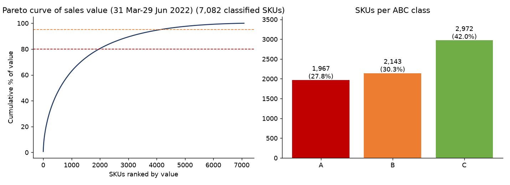
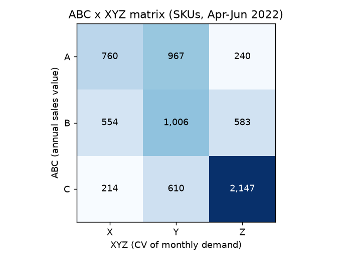

# Excel 01 — Inventory Control: ABC/XYZ Analysis

## Objective

Classify a catalog of 7,082 SKUs from an Amazon e-commerce dataset using ABC and XYZ analysis to identify high-value products, understand demand variability, and define appropriate inventory management strategies.

---

## Dataset

| Field | Detail |
|---|---|
| Source | Kaggle — [Amazon Sale Report](https://www.kaggle.com/datasets/thedevastator/unlock-profits-with-e-commerce-sales-data?resource=download&select=Amazon+Sale+Report.csv) |
| Author | thedevastator |
| Records | 107,160 shipped order lines (of ~129,000 in the source file) covering 7,082 SKUs |
| Period | 31 March 2022 — 29 June 2022 (about 3 months; April, May and June are full months) |
| File | Not included due to file size — download from source link above |

**Columns used:** `SKU`, `Category`, `Size`, `Date`, `Qty`, `Amount`

---

## Methodology

### Data Cleaning
- Filtered `Status = Shipped` only — cancelled and pending orders excluded
- Converted `Date` column from mixed text formats (`MM-DD-YY` and `MM-DD-YYYY`) to Excel date values
- Converted `Amount` from text with decimal point to numeric format
- Retained columns: SKU, Category, Size, Date, Qty, Amount
- Category names localized from Indian garment terminology to standard apparel terms

### ABC Analysis
Classification by **annual sales value** (Amount):

| Class | Criterion | SKUs | % of SKUs |
|---|---|---|---|
| A | Top 80% of total value | 1,967 | 27.6% |
| B | Next 15% of total value | 2,143 | 30.1% |
| C | Bottom 5% of total value | 2,972 | 41.8% |

> Note: ABC was calculated using sales value (revenue), not cost value, as cost data was not available in this dataset.

### XYZ Analysis
Classification by **demand variability** using Coefficient of Variation (CV = Std Dev / Mean of monthly Qty):

| Class | Criterion | SKUs | % of SKUs |
|---|---|---|---|
| X | CV < 0.5 — stable demand | 1,528 | 21.6% |
| Y | 0.5 ≤ CV < 1.0 — variable demand | 2,583 | 36.5% |
| Z | CV ≥ 1.0 — erratic demand | 2,970 | 41.9% |

CV is computed over the three full months (April–June 2022) for the 7,081 SKUs with sales in that window. Combined with ABC:

| | X | Y | Z |
|---|---|---|---|
| **A** | 760 | 967 | 240 |
| **B** | 554 | 1,006 | 583 |
| **C** | 214 | 610 | 2,147 |

> **Data correction.** In the workbook's `Clean Data` sheet the day and month were swapped for every date with a day ≤ 12 (the text `MM-DD-YY` was read with a day-first locale). That spread three months of sales over twelve calendar months and made almost every SKU look erratic (the workbook's `XYZ Analysis` sheet shows 0 X / 234 Y / 6,848 Z). The ABC result is not affected because it only uses total value. The figures above come from [`verify_xyz.py`](verify_xyz.py), which repairs the dates, recomputes XYZ and writes `results/xyz_recomputed.csv` and `results/abc_xyz_matrix.csv`. The `XYZ Analysis` sheet itself has not been rebuilt yet.

---

## File Structure

```
01_inventory_control/
├── 01_inventory_control.xlsx    ← Main analysis file
├── verify_xyz.py                ← Repairs the dates and recomputes XYZ / ABC×XYZ
├── results/                     ← Output of verify_xyz.py
├── images/                      ← Charts used in this README
└── README.md                    ← This file
```

**Sheets in the Excel file:**

| Sheet | Description |
|---|---|
| Raw Data | Original dataset as downloaded |
| Clean Data | Filtered and cleaned data (Shipped only, formatted dates and amounts) |
| ABC Analysis | SKU classification by annual sales value with cumulative % |
| XYZ Analysis | SKU classification by demand variability (CV) |
| Summary | Executive dashboard with KPIs and key insights |

---

## Results Preview





---

## Key Findings

1. **Pareto confirmed:** 27.6% of SKUs (Class A) represent 80% of total sales value.
2. **Demand is variable, with a long erratic tail:** 41.9% of SKUs are Class Z and 21.6% are Class X. Z is concentrated in the low-value tail (2,147 of the 2,972 Class C SKUs), not in the high-value SKUs.
3. **High-value SKUs are the most predictable:** 1,727 of the 1,967 Class A SKUs are X or Y (only 240 are Z). Class A–X (760 SKUs) is the natural candidate for fixed-cycle replenishment and tight control; C–Z (2,147 SKUs) calls for make-to-order or minimal stock.
4. **Policy by cell, not one rule for the catalog:** A–X/A–Y suit forecast-based replenishment with safety stock; B–Y and C–Y suit periodic review; Z items should not carry safety stock without a business case.

---

## Limitations

- **No cost data available** — ABC was calculated on revenue, not consumption cost. Results reflect sales importance, not procurement value.
- **Stock Status analysis excluded** — the dataset contains sales transactions only, with no inventory level data (current stock, min/max). A dedicated inventory dataset would be required for that analysis.
- **Short time window** — the dataset covers about 3 months, so each SKU has at most three monthly observations and CV is coarse (a SKU that sells once is automatically Z). A 12-month window is recommended for production use. Annual value in the ABC sheet is therefore a three-month value.

---

## Tools Used

- Microsoft Excel (Advanced)
- Pivot Tables
- SUMIF, COUNTIF, VLOOKUP
- Conditional Formatting
- TEXT, DATE, DATEVALUE functions
