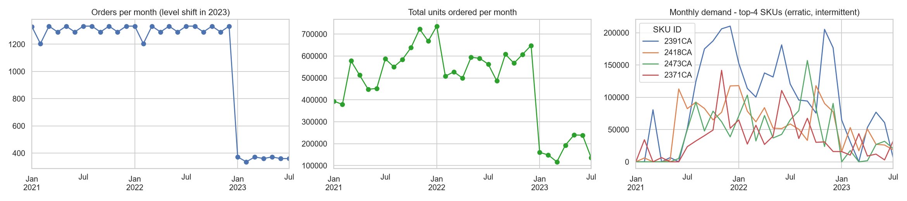
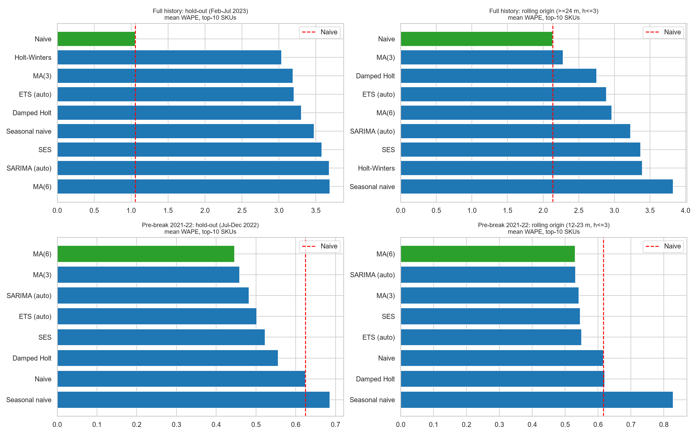
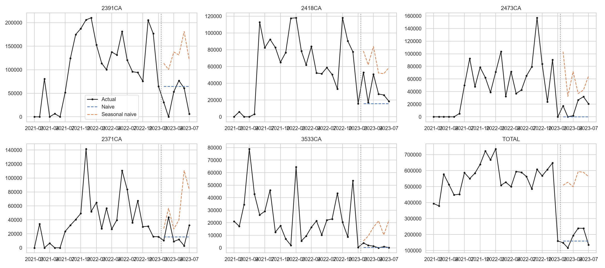
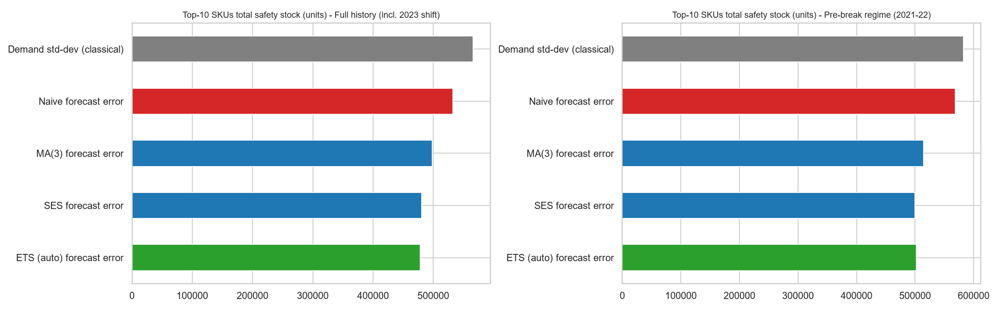

# ML 01 - Demand Forecasting for Inventory Planning

## Objective

Forecast monthly demand for the highest-volume SKUs of the Kaizen Analytics inventory dataset, compare classical forecasting methods under a strict time-based evaluation (hold-out + rolling origin), and translate forecast error into **safety-stock** requirements.

---

## Dataset

| Field | Detail |
|---|---|
| Source | Kaggle - [Dynamic Inventory Dataset - Kaizen Analytics](https://www.kaggle.com/datasets/andrewniko/dynamic-inventory-dataset-kaizen-analytics) (same file used in `python/02_inventory_optimization`) |
| Records | 33,919 sales orders, 290 SKUs sold (303 in the inventory sheet) |
| Period | January 2021 - July 2023 (31 months) |
| File | read from `../../python/02_inventory_optimization/dataset_kaizen analytics.xlsx` (a local copy next to the notebook is used first if present) |

**Series modelled:** monthly units ordered for the **top-10 SKUs by volume** (69.3% of all units) plus the **total across all SKUs**. Lead time and unit cost for the safety-stock translation come from the `Inventory Control` sheet.

---

## Methodology

### Models (all `statsmodels` / NumPy)
Naive, Seasonal naive (12 m), Moving average (3 and 6 months), Simple Exponential Smoothing, Damped Holt, Holt-Winters (additive trend + season), ETS (auto, AICc), SARIMA (auto, AICc). Seasonal components are only estimated with >= 24 months of training data.

### Validation (no random splitting, no look-ahead)
- **Hold-out:** train Jan-2021..Jan-2023 (25 months) -> forecast Feb..Jul 2023 (6 months).
- **Rolling origin:** expanding window, origins every month, horizon <= 3; comparison on origins with >= 24 months so every model is eligible.
- **Regime check:** the same two schemes restricted to 2021-2022 (before a level shift in 2023, see below).
- **Metrics:** WAPE (= sum|error| / sum(actual)), MAE, RMSE, bias. MAPE is not used because several SKU-months have zero demand.

### Forecast error -> safety stock
`SS = z * sigma * sqrt(L)` with `z = 1.645` (95% service), `L` = supplier lead time in months. Compared sigma definitions: demand standard deviation (classical, as in project 02) vs RMSE of one-step rolling forecast errors of Naive / MA(3) / SES / ETS.

---

## File Structure

```
ml/01_demand_forecasting/
├── 01_demand_forecasting.ipynb          <- Executed notebook (outputs and charts stored)
├── 01_demand_structure.png              <- Orders/units per month and top SKUs (shows the 2023 level shift)
├── 02_model_comparison.png              <- Mean WAPE per model, 4 evaluation settings
├── 03_holdout_forecasts.png             <- Actual vs forecasts on the hold-out
├── 04_safety_stock_impact.png           <- Safety stock by sigma definition
├── forecasts_all_origins.csv            <- Every forecast made (series, scheme, model, origin, horizon, actual, forecast)
├── metrics_*_summary.csv / *_per_series.csv   <- WAPE/MAE/RMSE/bias tables
├── safety_stock_*_full.csv / *_prebreak.csv   <- Safety stock tables (per SKU and summary)
├── requirements.txt
└── README.md
```

---

## Results Preview









---

## Key Findings

Mean WAPE over the 10 SKUs (lower = better):

| Evaluation | Naive | Best other model | Seasonal naive |
|---|---|---|---|
| Full history, hold-out (Feb-Jul 2023) | **1.05** | 3.04 (Holt-Winters) | 3.48 |
| Full history, rolling origin (>= 24 m) | **2.14** | 2.28 (MA(3)) | 3.83 |
| Stable 2021-22, hold-out (Jul-Dec 2022) | 0.62 | **0.45 (MA(6))** | 0.69 |
| Stable 2021-22, rolling origin | 0.62 | **0.53 (MA(6))**, SARIMA 0.53 | 0.83 |

1. **A level shift dominates everything.** Orders per month drop from ~1,300 to ~360 in January 2023 (-73%). Every smoothing / ETS / ARIMA model keeps forecasting the old level and misses by ~3x demand on the hold-out; only the naive forecast (re-anchors to the last month) is competitive. Total-demand hold-out WAPE: 25% naive vs 139% ETS.
2. **In the stable regime, smoothing beats naive moderately:** MA(6)/MA(3)/SARIMA/SES/ETS cut WAPE by 11-14% (rolling) and 16-28% (hold-out). Even the best method has ~45-55% WAPE per SKU-month (lumpy B2B orders, up to 7 zero-demand months); the total series is forecast at 7-12% WAPE.
3. **Seasonality could not be validated** with 31 months: seasonal naive is the worst or near-worst everywhere and seasonal models need >= 24 training months.
4. **Safety stock:** using the RMSE of SES/ETS/MA(3) one-step errors instead of raw demand standard deviation lowers total safety stock of the top-10 SKUs by 12-14% in units (stable regime: 582,868 -> ~500,000 units) and 11-13% in value (classical $2.79M vs $2.42M with ETS). Naive-forecast errors give **no** saving (+3% to +10% in value).

---

## Limitations

- 31 months, 290 SKUs, no price/promotion/stock-out data (orders shipped are used as demand; lost sales are invisible).
- The 2023 drop looks like a property of the data rather than a verified business event; it is reported, not corrected.
- Safety-stock sigma is estimated from only 12-19 one-step errors per SKU and assumes independent, roughly normal errors with sqrt(L) scaling; differences between SES, ETS and MA(3) are inside the noise (no significance test).
- Only univariate methods; no intermittent-demand methods (Croston/SBA), no hierarchical reconciliation, no machine-learning regressors.

---

## How to Reproduce

```bash
cd ml/01_demand_forecasting
pip install -r requirements.txt
jupyter nbconvert --to notebook --execute --inplace 01_demand_forecasting.ipynb
```
Runtime is a few minutes (rolling-origin refits run in parallel with `joblib`).

---

## Tools Used

| Tool | Purpose |
|---|---|
| Python 3.12 | Language |
| pandas / numpy | Data preparation, metrics |
| statsmodels | Exponential smoothing, ETS, SARIMA |
| joblib | Parallel rolling-origin evaluation |
| matplotlib / seaborn | Charts |
| openpyxl | Reading the Excel dataset |
