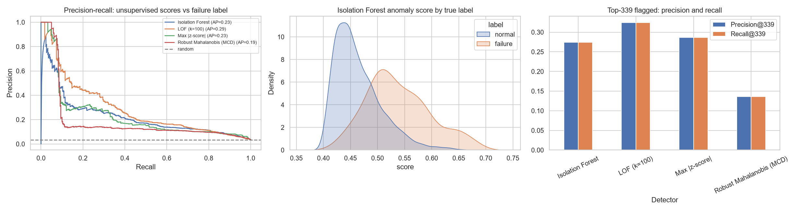
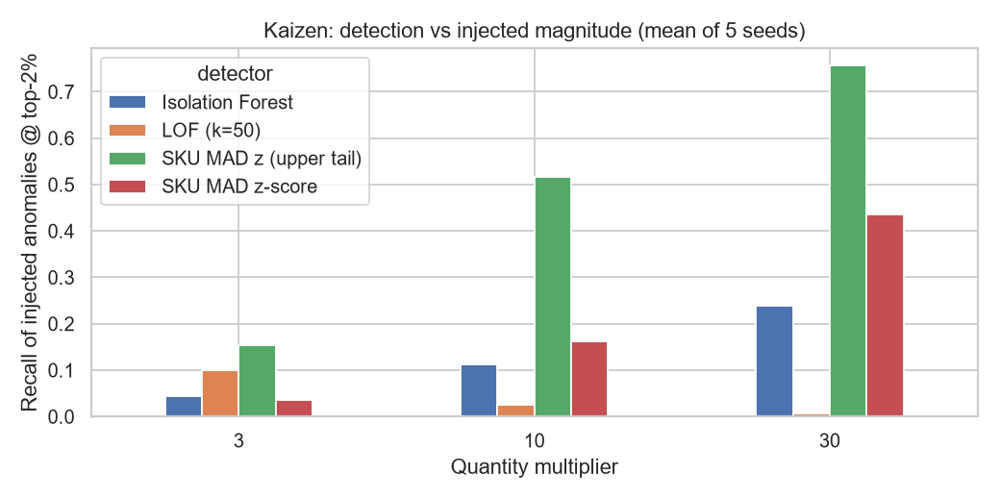
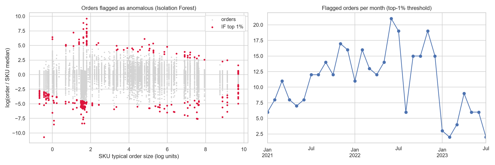

# ML 02 - Anomaly Detection (Unsupervised)

## Objective

Detect abnormal records without fitting on labels, and validate the detectors honestly: against a known failure label on machine-sensor data (labels used only for scoring) and, where no labels exist (supply-chain orders), by **injecting synthetic anomalies** and measuring how many are recovered.

---

## Dataset

| Field | Detail |
|---|---|
| A. Machine sensors | AI4I 2020 Predictive Maintenance (10,000 records, 3.39% failures) - `../../python/05_predictive_maintenance/ai4i2020.csv` |
| B. Supply-chain orders | Kaizen Analytics sales sheet (33,919 orders, 290 SKUs, 2021-2023) - `../../python/02_inventory_optimization/dataset_kaizen analytics.xlsx` |

Both files are read from the existing project folders (a local copy next to the notebook takes precedence). Sources: Kaggle AI4I 2020 and Kaggle Dynamic Inventory Dataset (Kaizen Analytics), as documented in those projects.

---

## Methodology

### Part A - AI4I sensors
- Features: 5 sensor/process variables + temperature difference + mechanical power. Failure flags (`Machine failure`, `TWF/HDF/PWF/OSF/RNF`) are **never** features or tuning targets.
- Detectors: Isolation Forest (300 trees), LOF (k=100, fixed a priori), max |z-score|, robust Mahalanobis (MCD).
- Evaluation against the label: ROC-AUC, PR-AUC (base rate 0.034), precision/recall at a review budget of the top 339 records, recall by failure mode, LOF sensitivity to k, and a supervised Random Forest (5-fold CV) as an upper-bound reference.

### Part B - Kaizen orders
- Features per order: `log(quantity)`, `log(quantity / SKU median)`, SKU typical size. Unit price is constant per SKU, so it carries no signal.
- Detectors: Isolation Forest, LOF, per-SKU modified z-score (MAD) two-sided and upper-tail.
- Validation by injection: multiply 1% of order quantities by x3 / x10 / x30, refit on the contaminated data, measure recall within the top-2% flagged (5 seeds).
- Review of the real top-1% flagged orders and an upward-spike list for planners.

---

## File Structure

```
ml/02_anomaly_detection/
├── 02_anomaly_detection.ipynb              <- Executed notebook (outputs and charts stored)
├── 01_ai4i_detector_comparison.png         <- PR curves, score distributions, top-K precision/recall
├── 02_kaizen_injection_recall.png          <- Injection test: recall vs magnitude
├── 03_kaizen_flagged_orders.png            <- Flagged orders (scatter + monthly count)
├── ai4i_anomaly_scores.csv                 <- Scores of every detector + Isolation Forest flag per machine
├── metrics_ai4i_unsupervised.csv / metrics_ai4i_recall_by_failure_mode.csv
├── metrics_kaizen_injection_runs.csv / metrics_kaizen_injection_summary.csv
├── kaizen_flagged_orders_top1pct.csv       <- Top 1% orders by Isolation Forest
├── kaizen_upward_spikes_top1pct.csv        <- Top 1% upward spikes (per-SKU robust z)
├── requirements.txt
└── README.md
```

---

## Results Preview







---

## Key Findings

1. **AI4I (labels only used for scoring):** Isolation Forest ROC-AUC 0.855 / PR-AUC 0.226; LOF(k=100) 0.860 / 0.289; max-z 0.851 / 0.232; robust Mahalanobis 0.828 / 0.187 (random PR-AUC = 0.034). Top-339 precision 27-32% for the best three (8-10x lift). A supervised RF reaches 0.974 / 0.850, so unsupervised detection is a screening tool, not a substitute.
2. **Failure mode matters:** power failures are found well (max-z 94%, LOF 81%, IF 73% in the top-K), overstrain 16-35%, heat dissipation 1-11%, tool wear 4-15%, random failures 0% (unobservable by construction).
3. **Kaizen injection test:** x3 errors are indistinguishable from normal spread; for x10 / x30 the per-SKU upper-tail MAD z-score recovers 52% / 76% of injected spikes in the top 2%, Isolation Forest 11% / 24%, LOF ~1-3% (unsuitable as configured). Heavy two-sided tails (8.9% of orders below 1 unit) crowd the generic detectors.
4. **Real orders:** the top-1% Isolation Forest list is 148 above / 191 below the SKU median; the upward-spike list (e.g. an order of 88,200 units for a SKU with a typical order of 6) is the actionable review queue. These are candidates, not confirmed errors.

---

## Limitations

- AI4I is synthetic with rule-based failure labels; results may not transfer to real machines. The review budget K uses the known failure rate.
- The injection test covers only multiplicative upward errors; natural anomalies count as false positives, so precision is understated.
- Orders are scored cross-sectionally per SKU, without time, seasonality, customer or warehouse context.
- LOF `k` was fixed a priori; its sensitivity is reported but not tuned on labels.

---

## How to Reproduce

```bash
cd ml/02_anomaly_detection
pip install -r requirements.txt
jupyter nbconvert --to notebook --execute --inplace 02_anomaly_detection.ipynb
```

---

## Tools Used

| Tool | Purpose |
|---|---|
| Python 3.12 | Language |
| pandas / numpy | Data preparation |
| scikit-learn | Isolation Forest, LOF, MCD, metrics, supervised reference |
| matplotlib / seaborn | Charts |
| openpyxl | Reading the Excel dataset |
