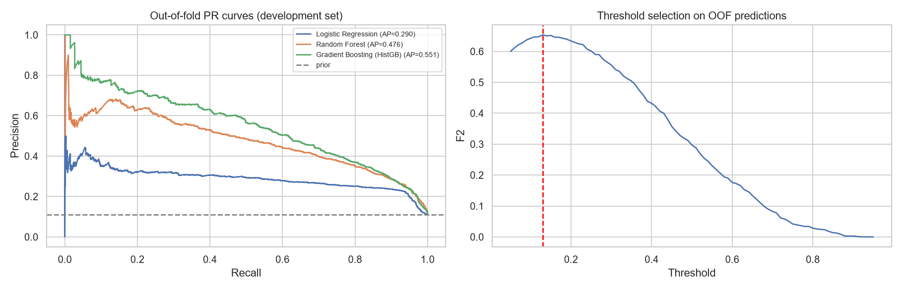
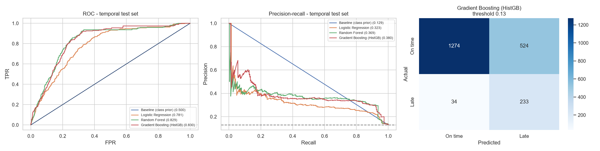
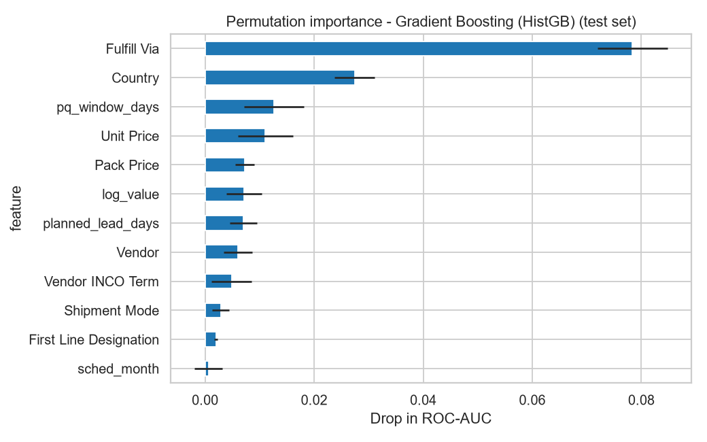

# ML 03 - Classification: Predicting Late Deliveries in a Health-Commodity Supply Chain

## Objective

Predict, when a shipment is planned, whether it will be delivered **later than its scheduled delivery date**, so planners can expedite, add buffer stock or re-route at-risk orders. Compare logistic regression, random forest and gradient boosting under class imbalance, with leakage control and a chronological test.

---

## Dataset

| Field | Detail |
|---|---|
| Source | USAID / PEPFAR - *Supply Chain Shipment Pricing Data* (SCMS Delivery History). Public, no login. Official page: <https://data.usaid.gov/HIV-AIDS/Supply-Chain-Shipment-Pricing-Data/a3rc-nmf6>; the CSV used here is a public mirror: <https://github.com/jrcinco/supply-chain-shipment-price-data> |
| Records | 10,324 shipment line items, 33 columns, scheduled dates 2006-2015 |
| File | `SCMS_Delivery_History_Dataset.csv` (3.8 MB, included) |
| Target | `late = Delivered to Client Date > Scheduled Delivery Date` -> 11.49% late (1,186 shipments) |

---

## Methodology

- **No leakage by design:** the two date columns that define the target (`Delivered to Client Date`, `Delivery Recorded Date`) and identifiers (`ID`, `PO/SO #`, `ASN/DN #`) are not features. Weight and freight cost (possibly recorded after shipment) are excluded and tested separately in the leakage audit.
- **Features known at planning time:** country, fulfilment route, INCO term, shipment mode, product group/sub-class, vendor, dosage form, brand, first-line flag, log quantity/value, pack/unit price, scheduled year/month, planned lead time (scheduled minus PO date) and PQ-to-schedule window; median imputation with missing indicators, one-hot encoding (rare categories grouped).
- **Validation:** chronological split (oldest 80% = development, newest 20% = test, never used for selection); **stratified 5-fold CV** on the development set for model comparison; decision threshold chosen on out-of-fold predictions only (maximise F2, because a missed late delivery costs more than a false alarm).
- **Models:** class-prior baseline, Logistic Regression (balanced), Random Forest (balanced subsample), Histogram Gradient Boosting; hyper-parameters fixed a priori.
- **Metrics:** ROC-AUC, PR-AUC (base rate 0.11-0.13), confusion matrix at the chosen threshold, operating points by share flagged, bootstrap CI, permutation importance.
- **Audit:** shuffled-label run, random-CV vs chronological gap, effect of suspect columns, single-feature sanity check.

---

## File Structure

```
ml/03_classification_model/
├── 03_classification_model.ipynb       <- Executed notebook (outputs and charts stored)
├── SCMS_Delivery_History_Dataset.csv   <- Dataset (3.8 MB)
├── 01_cv_pr_curves_threshold.png       <- Out-of-fold PR curves + threshold selection
├── 02_test_roc_pr_confusion.png        <- Test-set ROC, PR and confusion matrix
├── 03_permutation_importance.png       <- Feature importance
├── cv_model_comparison.csv / test_model_comparison.csv / test_operating_points.csv
├── leakage_audit.csv / feature_importance_permutation.csv
├── test_set_predictions.csv            <- Probability and prediction for each test shipment
├── requirements.txt
└── README.md
```

---

## Results Preview







---

## Key Findings

| Model | CV ROC-AUC | CV PR-AUC | Test ROC-AUC | Test PR-AUC |
|---|---|---|---|---|
| Baseline (prior) | 0.500 | 0.111 | 0.500 | 0.129 |
| Logistic Regression | 0.810 | 0.296 | 0.781 | 0.323 |
| Random Forest | 0.886 | 0.480 | 0.829 | 0.369 |
| **Gradient Boosting** | **0.896** | **0.554** | **0.830** (CI 0.804-0.854) | **0.380** (CI 0.330-0.436) |

1. Gradient boosting / random forest clearly beat logistic regression; on the newer test period all scores drop (ROC-AUC 0.896 -> 0.830) because late-delivery patterns drift over time (late rate by year: 0-4% through 2009, 16% 2010, 24% 2011, 8% 2012, 18% 2013).
2. At the F2-optimal threshold 0.13: TN=1,274, FP=524, FN=34, TP=233 -> recall 87.3%, precision 30.8%, 36.7% of shipments flagged. Flagging only the top 10% gives 36.9% precision (2.9x base rate), 28.5% recall.
3. Biggest driver: fulfilment route - shipments **From RDC are late 17.2% vs 5.3% for Direct Drop**; then country; Truck/Ocean (16-18%) are later than Air (9.6%).
4. Leakage audit passed: shuffled labels -> ROC-AUC 0.476; adding weight/freight changes nothing (0.897 vs 0.896).

---

## Limitations

- Moderate signal: PR-AUC 0.38 on the newest period, ~30-35% precision at useful recall.
- Strong temporal drift, and early-year scheduled dates may have been back-filled; trust the temporal test, not the CV.
- `Shipment Mode` is assumed known at planning time. Class-weighted models are poorly calibrated; no explicit calibration. Hyper-parameters not tuned; F2 stands in for an unknown cost matrix.

---

## How to Reproduce

```bash
cd ml/03_classification_model
pip install -r requirements.txt
jupyter nbconvert --to notebook --execute --inplace 03_classification_model.ipynb
```

---

## Tools Used

| Tool | Purpose |
|---|---|
| Python 3.12 | Language |
| pandas / numpy | Data preparation |
| scikit-learn | Pipelines, models, CV, metrics, permutation importance |
| matplotlib / seaborn | Charts |
