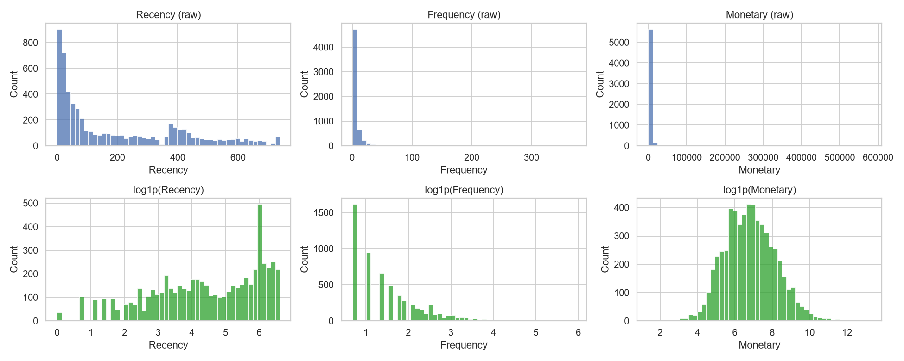
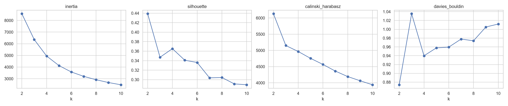
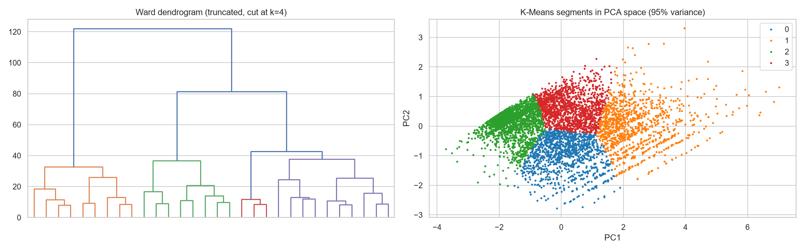
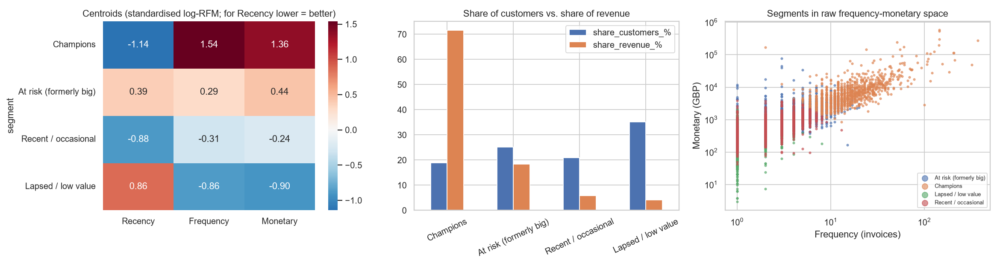
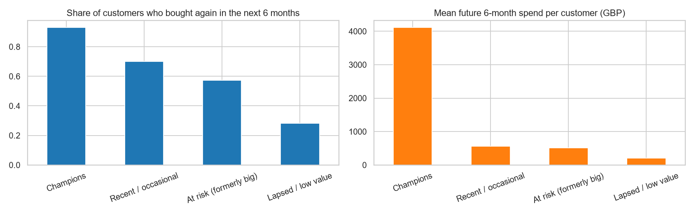

# ML 04 - Customer Segmentation: RFM + K-Means / Hierarchical Clustering

## Objective

Segment customers of a UK online wholesaler by purchasing behaviour (Recency, Frequency, Monetary value), choose the number of segments with objective criteria, test that the segments are stable and **predictive of future spend**, and describe them in business terms.

---

## Dataset

| Field | Detail |
|---|---|
| Source | UCI Machine Learning Repository - [Online Retail II](https://archive.ics.uci.edu/dataset/502/online+retail+ii) (CC BY 4.0), no login |
| Records | 1,067,371 transaction lines, 01-Dec-2009 to 09-Dec-2011 (two Excel sheets) |
| Size | 45 MB zip / 45 MB xlsx - **not stored in the repo** |
| Access | The notebook downloads `https://archive.ics.uci.edu/static/public/502/online+retail+ii.zip` automatically into `data/` (git-ignored; override with env var `RETAIL_CACHE_DIR`) and caches a CSV. The first run takes a few minutes (Excel parsing). |

---

## Methodology

- **Cleaning (row counts logged):** drop lines without Customer ID, cancellations, non-positive quantity/price, non-product codes (postage, fees, adjustments), exact duplicates -> 776,579 lines, 5,852 customers.
- **RFM:** snapshot = day after last transaction; Recency (days), Frequency (distinct invoices), Monetary (GBP); `log1p` + standardisation to tame skewness (Monetary skew 25 -> 0.3).
- **Choosing k:** K-Means k=2..10 with inertia, silhouette, Calinski-Harabasz, Davies-Bouldin, minimum cluster size, plus bootstrap stability (30 resamples, ARI).
- **Cross-check:** Ward hierarchical clustering vs K-Means (silhouette, ARI), dendrogram, PCA projection.
- **Profiling:** segment sizes, revenue share and medians; names assigned by a rule on centroids.
- **Forward validation:** RFM rebuilt on data before 9-Jun-2011, K-Means refit (k=4), then repurchase rate and spend of each segment over the next 6 months.

---

## File Structure

```
ml/04_customer_clustering/
├── 04_customer_clustering.ipynb    <- Executed notebook (outputs and charts stored)
├── 01_rfm_distributions.png        <- Raw vs log-transformed RFM
├── 02_choose_k.png                 <- Elbow / silhouette / CH / Davies-Bouldin
├── 03_dendrogram_pca.png           <- Ward dendrogram + PCA view of segments
├── 04_segment_profiles.png         <- Centroid heatmap, revenue share, FM scatter
├── 05_forward_validation.png       <- Repurchase rate / future spend by segment
├── cluster_selection_metrics.csv / cluster_stability.csv
├── segment_profile.csv / customer_segments.csv   <- Segment of every customer
├── forward_validation_segments.csv
├── .gitignore                      <- ignores the downloaded data/ folder
├── requirements.txt
└── README.md
```

---

## Results Preview











---

## Key Findings

1. **k = 4** (silhouette 0.365, Davies-Bouldin 0.94, bootstrap ARI 0.92, smallest cluster 1,110 customers). k=2 scores higher statistically (silhouette 0.439) but only separates active from lapsed customers; elbow is gradual.
2. **Segments:** Champions 19% of customers / **71.6% of revenue** (recency 15 days, 13 invoices, GBP 5,118 median); At risk (formerly big) 25% / 18.5% (157 days since last order); Recent/occasional 21% / 5.9%; Lapsed/low value 35% / 4.1%.
3. **Forward validation:** on the next 6 months Champions repurchase 93% and generate 65.6% of future revenue (GBP 4,117 per customer); then 70% / 57% / 28% repurchase and GBP 562 / 516 / 207 per customer for the other segments - monotonic ordering.
4. Ward clustering fits worse (silhouette 0.29, ARI 0.53 vs K-Means): the customer base is a continuum with soft boundaries.

---

## Limitations

- RFM ignores what is bought, margin and returns; 22.8% of lines have no Customer ID and are not segmented.
- Silhouette 0.29-0.44 = overlapping clusters; names are rule-based. Single retailer, single forward-test cut-off, exact duplicates removed (3.2% of rows).

---

## How to Reproduce

```bash
cd ml/04_customer_clustering
pip install -r requirements.txt
jupyter nbconvert --to notebook --execute --inplace 04_customer_clustering.ipynb
```
(needs internet on the first run; set `RETAIL_CACHE_DIR` to reuse a downloaded copy.)

---

## Tools Used

| Tool | Purpose |
|---|---|
| Python 3.12 | Language |
| pandas / numpy | Cleaning and RFM |
| scikit-learn | KMeans, Agglomerative/PCA, cluster metrics |
| scipy | Ward linkage and dendrogram |
| openpyxl | Reading the Excel source |
| matplotlib / seaborn | Charts |
