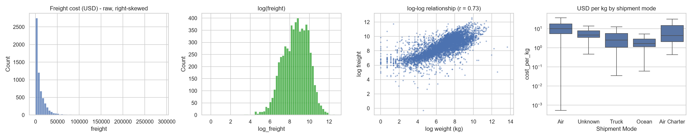
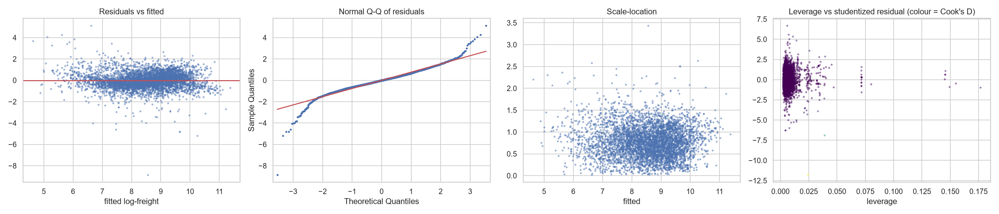
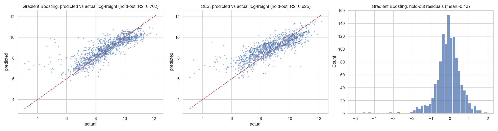
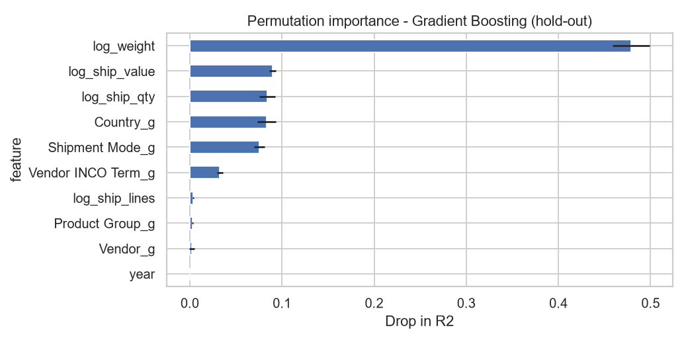

# ML 05 - Regression Analysis: Estimating Freight Cost per Shipment

## Objective

Predict the **freight cost (USD)** of a health-commodity shipment from information available at planning time and quantify what drives it (e.g. cost elasticity of weight). Combines an **inferential OLS model with full diagnostics** and a **predictive comparison** against regularised and tree models.

---

## Dataset

| Field | Detail |
|---|---|
| Source | USAID / PEPFAR - *Supply Chain Shipment Pricing Data* (SCMS Delivery History), public, no login. Official page: <https://data.usaid.gov/HIV-AIDS/Supply-Chain-Shipment-Pricing-Data/a3rc-nmf6>; CSV mirror: <https://github.com/jrcinco/supply-chain-shipment-price-data> |
| Records | 10,324 shipment lines; **6,174** with numeric freight and weight are modelled |
| File | `SCMS_Delivery_History_Dataset.csv` (3.8 MB, included; same file as project 03) |
| Target | `log(Freight Cost USD)` (raw cost skew 4.7 -> log skew -0.37) |

Lines whose freight is text ("Freight Included in Commodity Cost" 1,442, "Invoiced Separately" 239, "See DN-xxx" references 2,445) are excluded - a selection effect.

---

## Methodology

- **Features:** log weight, shipment-level log quantity / log value / log number of lines (aggregated over all lines of the same ASN/DN), year, shipment mode, country, INCO term, product group, vendor (rare levels grouped on the development set). Fulfilment route was dropped (perfectly collinear with INCO term).
- **Split:** chronological, oldest 80% (dev) / newest 20% (hold-out).
- **OLS (statsmodels):** HC3-robust 95% CIs, Breusch-Pagan, Shapiro-Wilk, Q-Q, scale-location, VIF, Cook's distance / leverage, refit without influential points.
- **Predictive comparison:** mean baseline, "median USD/kg by mode x weight" rule, OLS, RidgeCV, LassoCV, ElasticNetCV, Random Forest, Histogram Gradient Boosting; **GroupKFold (by shipment)** CV on the dev set, then one evaluation on the hold-out; bootstrap CI; error by shipment mode; permutation importance.
- **Metrics:** R2 and RMSE (log), MAE (USD), median absolute % error, WAPE.

---

## File Structure

```
ml/05_regression_analysis/
├── 05_regression_analysis.ipynb        <- Executed notebook (outputs and charts stored)
├── SCMS_Delivery_History_Dataset.csv   <- Dataset (3.8 MB)
├── 01_target_exploration.png           <- Freight distribution, log-log scatter, cost per kg by mode
├── 02_ols_diagnostics.png              <- Residual / Q-Q / scale-location / leverage plots
├── 03_holdout_predictions.png          <- Predicted vs actual, residuals
├── 04_permutation_importance.png
├── ols_coefficients.csv / ols_diagnostics.csv
├── cv_model_comparison.csv / test_model_comparison.csv / test_error_by_shipment_mode.csv
├── feature_importance_permutation.csv / test_set_predictions.csv
├── requirements.txt
└── README.md
```

---

## Results Preview









---

## Key Findings

- **OLS (dev, n=4,939):** R2 0.640. **Weight elasticity 0.36 (95% CI 0.31-0.41)** - freight grows much slower than weight (0.445 without influential points). At equal weight, Truck is 34% cheaper than Air (CI -39% to -28%), Air Charter 33% dearer, Ocean not distinguishable; costs rose ~4.5%/year. Diagnostics: heteroscedasticity (Breusch-Pagan p~1e-24, robust SEs used), heavy-tailed residuals (excess kurtosis 7.1), moderate VIFs (<= 6), 5.1% of points with Cook's D > 4/n.
- **Prediction:**

| Model | CV R2 | Hold-out R2 | Hold-out MAE (USD) | Hold-out WAPE |
|---|---|---|---|---|
| Baseline: mean log-cost | 0.000 | -0.021 | 11,131 | 0.806 |
| Baseline: median USD/kg x weight | -0.059 | 0.392 | 13,250 | 0.959 |
| OLS | 0.633 | 0.625 | 6,639 | 0.481 |
| Ridge / Lasso / ElasticNet | 0.629-0.633 | 0.626-0.629 | 6,595-6,637 | 0.477-0.480 |
| Random Forest | 0.740 | 0.695 | 6,285 | 0.455 |
| **Gradient Boosting** | **0.759** | **0.702** (CI 0.657-0.740) | **6,120** | **0.443** |

- Trees add ~0.07-0.12 R2 over the linear family; regularisation adds nothing here. Even the best model errs by ~44% of the freight bill (median 36%): useful for budgeting aggregates and flagging implausible quotes, not for pricing one shipment. Hold-out < CV because of drift (median USD/kg fell 7.65 -> 6.04). Weight dominates importance (R2 drop 0.48).

---

## Limitations

- Only shipments with an explicit freight value are modelled (selection bias); weight is known only after consolidation.
- Price drift 2006-2015 handled by a linear year term only; heavy-tailed, heteroscedastic residuals (CIs are robust-SE based, not exact).
- Predictions are back-transformed without smearing (conditional median); tree hyper-parameters fixed, not tuned.

---

## How to Reproduce

```bash
cd ml/05_regression_analysis
pip install -r requirements.txt
jupyter nbconvert --to notebook --execute --inplace 05_regression_analysis.ipynb
```

---

## Tools Used

| Tool | Purpose |
|---|---|
| Python 3.12 | Language |
| pandas / numpy / scipy | Data preparation, tests |
| statsmodels | OLS, robust covariance, diagnostics, VIF |
| scikit-learn | Regularised and tree models, GroupKFold, permutation importance |
| matplotlib / seaborn | Charts |
