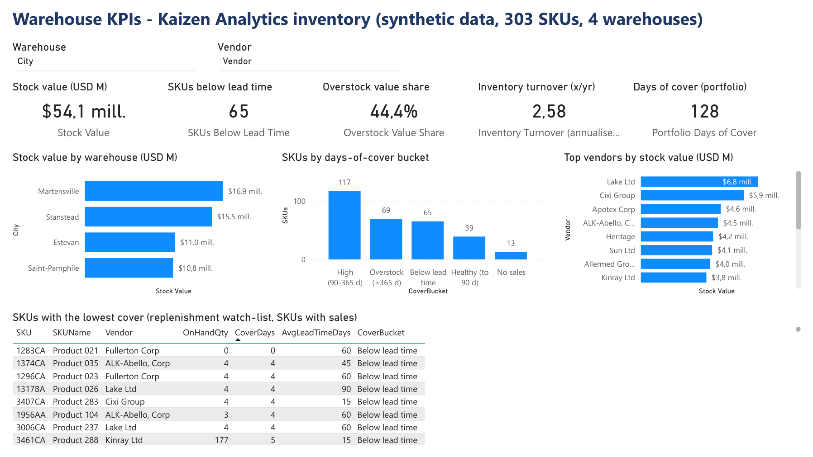
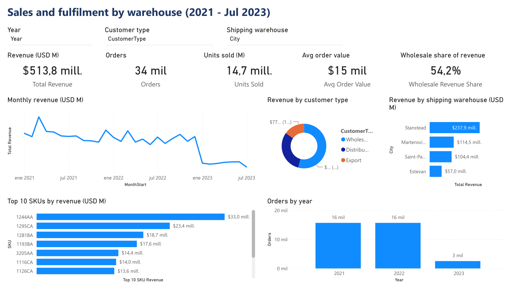

# Power BI 01 - Warehouse KPIs

## Objective

Monitor warehouse inventory health (stock value, days of cover against supplier lead time, overstock) and sales fulfilment for a four-warehouse network, using a star-style model with DAX measures and calculated columns.

---

## Dataset

| Field | Detail |
|---|---|
| Source | Kaizen Analytics - Dynamic Inventory Dataset ([Kaggle](https://www.kaggle.com/datasets/andrewniko/dynamic-inventory-dataset-kaizen-analytics)); same workbook used in Python 02 and SQL 01/04 |
| Records | 303 SKUs (inventory snapshot), 33,919 sales orders, 4 warehouses |
| Period | Orders from 1 Jan 2021 to 30 Jul 2023 |
| Files | `data/kaizen_inventory.csv`, `data/kaizen_sales.csv`, `data/kaizen_warehouses.csv` (extracted from the workbook; `SalesCost` = order quantity x SKU unit cost) |

---

## Data Model

| Table | Grain | Notes |
|---|---|---|
| `Inventory` | one row per SKU | stock, cost, lead times; calculated columns `DailyDemand`, `CoverDays`, `CoverBucket` |
| `Sales` | one row per order | quantity, revenue, cost |
| `Warehouses` | one row per warehouse | city, province, coordinates |
| `Calendar` | one row per day | DAX calculated table |

Relationships: `Warehouses -> Inventory`, `Warehouses -> Sales`, `Calendar -> Sales`. `Inventory` and `Sales` are deliberately not related: the sales warehouse of an order matches the SKU's stocking warehouse in only 25.7% of orders (a sign the data is synthetic), so SKU-level demand is computed in `DailyDemand` with an explicit filter on `SKU`.

---

## Key DAX Measures

| Measure | Purpose |
|---|---|
| Stock Value, Units On Hand, SKUs | Inventory size |
| SKUs Below Lead Time | SKUs whose days of cover are shorter than their average lead time |
| Overstock Value Share | Share of stock value held in SKUs with more than 365 days of cover |
| Inventory Turnover (annualised) | Annualised cost of goods sold / stock value over the sales history |
| Portfolio Days of Cover | Units on hand / average daily units sold |
| Total Revenue, Orders, Avg Order Value, Wholesale Revenue Share | Sales KPIs |
| Revenue YoY % | Year-over-year change; only evaluates when a single year is selected in the Year slicer |
| Top 10 SKU Revenue | RANKX-based measure that keeps the ten best SKUs and blanks the rest |

Measures are grouped in display folders; implicit measures are disabled so every number on the report comes from a named measure.

---

## Results Preview

### Page 1 - Inventory Health



### Page 2 - Sales & Fulfilment



---

## Key Findings

1. The 303 SKUs hold **$54.13M** of stock; annualised inventory turnover is **2.58x** and the portfolio holds about **128 days** of cover.
2. **65 SKUs** have less cover than their average lead time (stock-out risk) while **69 SKUs** hold more than a year of cover and account for **44.4%** of stock value.
3. Sales history: **33,919 orders** and **$513.8M** revenue, **54.2%** of it from wholesale customers; the orders-per-month level falls sharply from January 2023, which looks like an artefact of the dataset rather than a real trend (documented in SQL 02 and ML 01).

All headline numbers were checked independently with pandas (`powerbi/verify_numbers.py`) and match the report.

---

## How to open

1. Install **Power BI Desktop** (built and tested with version 2.159, Nov 2026). Projects in the `.pbip` format open directly; if your build asks for it, enable *Options > Preview features > Power BI Project (.pbip) save option*.
2. Open `Warehouse_KPIs.pbip`.
3. The CSV files are read through one Power Query parameter, **`DataFolder`**. It points to this project's `data` folder on the author's machine. Set it to your local path in *Transform data > Edit parameters* (or in `Warehouse_KPIs.SemanticModel/definition/expressions.tmdl`).
4. Click **Refresh**. On a first open Power BI may show "calculated objects must be refreshed manually": use *Refresh now*.

---

## File Structure

```
01_warehouse_kpis/
├── Warehouse_KPIs.pbip                 <- open this in Power BI Desktop
├── Warehouse_KPIs.SemanticModel/       <- tables, relationships and measures (TMDL text files)
├── Warehouse_KPIs.Report/              <- pages and visuals (PBIR JSON files)
├── data/                            <- CSV files read by Power Query
├── images/                          <- screenshots used in this README
└── README.md
```

---

## Limitations

- The Kaizen dataset appears synthetic (unit price is exactly cost / 0.7 for every SKU and sales warehouses are unrelated to stocking warehouses). Use it to demonstrate the method, not to draw business conclusions.
- Days of cover uses the average daily demand over the whole history, so the low-volume 2023 months pull demand down. A different window changes the counts (SQL 01 uses 12 months and reports 49 SKUs below lead time).
- Quantities mix units (`Nos` and `Kg`) as in the source data.

---

## Tools Used

Power BI Desktop (PBIP project format: TMDL semantic model + PBIR report), DAX, Power Query (M), Python/pandas for data preparation and independent verification of the headline numbers.
