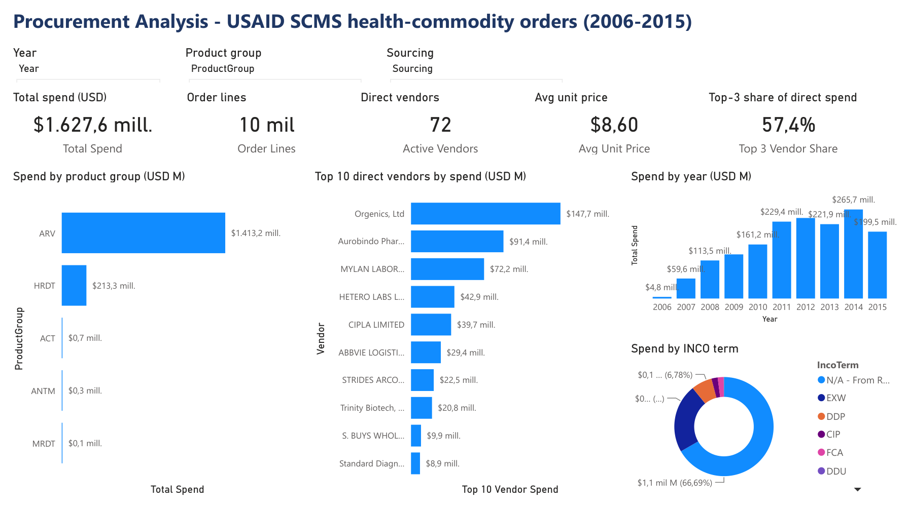
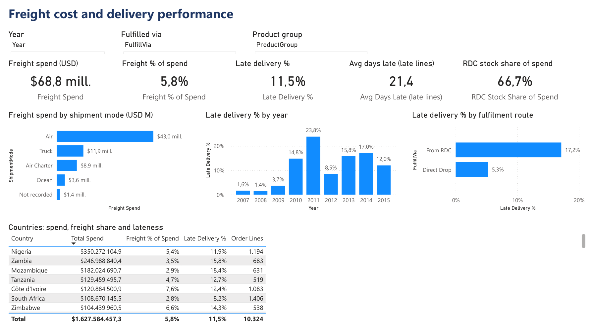

# Power BI 02 - Procurement Analysis

## Objective

Analyse procurement spend, vendor concentration, sourcing route, freight cost and delivery performance of a large public health supply chain.

---

## Dataset

| Field | Detail |
|---|---|
| Source | USAID / PEPFAR Supply Chain Shipment Pricing Data ([USAID Data](https://data.usaid.gov/HIV-AIDS/Supply-Chain-Shipment-Pricing-Data/a3rc-nmf6)); same file as ML 03 and ML 05 |
| Records | 10,324 order lines, 142 project codes, 43 countries, 73 vendors |
| Period | Deliveries from May 2006 to September 2015 |
| Files | `data/scms_lines.csv` (cleaned extract: dates parsed, freight text split into a numeric column and a `FreightType` flag, `Sourcing` flag) |

---

## Data Model

| Table | Grain | Notes |
|---|---|---|
| `Shipments` | one row per order line | value, quantity, vendor, route, freight, delivery dates, `Sourcing`, `OnTime` |
| `Calendar` | one row per day | DAX calculated table, related on `DeliveredDate` |

`Sourcing` separates lines bought **directly from a vendor** from lines served from the regional distribution centre (the pseudo-vendor "SCMS from RDC"), so vendor concentration is not distorted by internal stock transfers.

---

## Key DAX Measures

| Measure | Purpose |
|---|---|
| Total Spend, Order Lines, Units Procured, Avg Unit Price | Spend and price (weighted by units) |
| Direct Vendor Spend, Active Vendors | Spend and count of vendors for direct purchases only |
| Top 10 Vendor Spend, Top 3 Vendor Share | RANKX / TOPN concentration measures on direct spend |
| RDC Stock Share of Spend | Share of spend served from regional stock |
| Spend YoY % | Year-over-year change with SAMEPERIODLASTYEAR; only evaluates when a single year is selected |
| Freight Spend, Freight % of Spend | Freight cost, and freight as a share of the goods value of the lines that have a numeric freight cost |
| Late Delivery %, Avg Days Late (late lines) | Delivered date later than scheduled date |

Measures are grouped in display folders; implicit measures are disabled so every number on the report comes from a named measure.

---

## Results Preview

### Page 1 - Procurement Overview



### Page 2 - Freight & Delivery



---

## Key Findings

1. Total spend is **$1,627.6M** over 10,324 lines. **66.7%** of it was served from regional stock rather than bought directly; direct purchases total **$542.2M** from **72 vendors**.
2. Vendor concentration among direct purchases is high: **Orgenics, Aurobindo and Mylan make up 57.4%** of direct spend (Orgenics alone $147.7M).
3. Antiretrovirals (ARV) are **86.8%** of spend ($1,413.2M); annual spend peaked at $265.7M in 2014.
4. **11.5%** of lines were delivered late (average 21.4 days late). Lines served from regional stock are late **17.2%** of the time against **5.3%** for direct drop, the same pattern the ML 03 classifier finds.
5. Where freight is priced it equals **5.8%** of goods value ($68.8M); air freight is $43.0M of it.

All headline numbers were checked independently with pandas (`powerbi/verify_numbers.py`) and match the report.

---

## How to open

1. Install **Power BI Desktop** (built and tested with version 2.159, Nov 2026). Projects in the `.pbip` format open directly; if your build asks for it, enable *Options > Preview features > Power BI Project (.pbip) save option*.
2. Open `Procurement_Analysis.pbip`.
3. The CSV files are read through one Power Query parameter, **`DataFolder`**. It points to this project's `data` folder on the author's machine. Set it to your local path in *Transform data > Edit parameters* (or in `Procurement_Analysis.SemanticModel/definition/expressions.tmdl`).
4. Click **Refresh**. On a first open Power BI may show "calculated objects must be refreshed manually": use *Refresh now*.

---

## File Structure

```
02_procurement_analysis/
├── Procurement_Analysis.pbip                 <- open this in Power BI Desktop
├── Procurement_Analysis.SemanticModel/       <- tables, relationships and measures (TMDL text files)
├── Procurement_Analysis.Report/              <- pages and visuals (PBIR JSON files)
├── data/                            <- CSV files read by Power Query
├── images/                          <- screenshots used in this README
└── README.md
```

---

## Limitations

- Freight is numeric for only 60% of lines; the rest is included in the commodity cost or referenced to another shipment, so freight totals cover priced lines only.
- Vendor names are used as given in the source (some vendors appear under several spellings).
- Currency is USD, nominal (no inflation adjustment).

---

## Tools Used

Power BI Desktop (PBIP project format: TMDL semantic model + PBIR report), DAX, Power Query (M), Python/pandas for data preparation and independent verification of the headline numbers.
