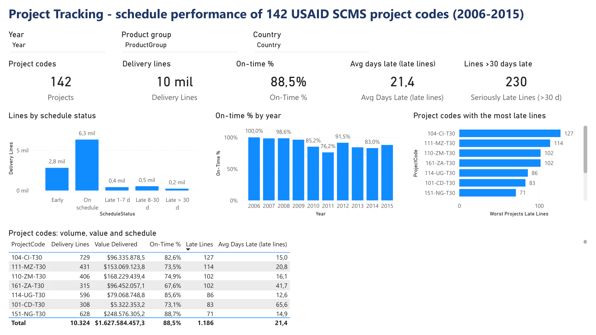
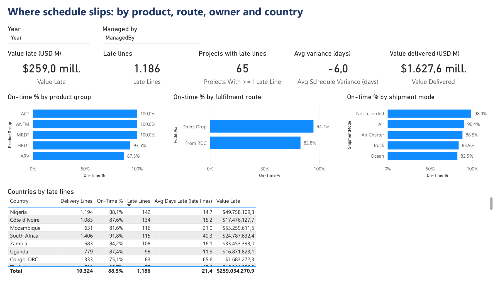

# Power BI 03 - Project Tracking

## Objective

Track schedule performance across a portfolio of 142 project codes: how many deliveries were early, on schedule or late, how late, and where the slippage concentrates.

---

## Dataset

| Field | Detail |
|---|---|
| Source | USAID / PEPFAR Supply Chain Shipment Pricing Data ([USAID Data](https://data.usaid.gov/HIV-AIDS/Supply-Chain-Shipment-Pricing-Data/a3rc-nmf6)); project code = the programme/order code in the file |
| Records | 10,324 delivery lines grouped in 142 project codes |
| Period | Deliveries from May 2006 to September 2015 |
| Files | `data/scms_lines.csv` (same cleaned extract as Procurement Analysis and Operational Costs) |

---

## Data Model

| Table | Grain | Notes |
|---|---|---|
| `Deliveries` | one row per delivery line | scheduled and delivered dates, `DaysLate`, calculated `ScheduleStatus` (sorted by `ScheduleOrder`) |
| `Calendar` | one row per day | DAX calculated table, related on `DeliveredDate` |

`DaysLate` = delivered date minus scheduled date (negative = early). `ScheduleStatus` buckets: Early, On schedule, Late 1-7 d, Late 8-30 d, Late > 30 d.

---

## Key DAX Measures

| Measure | Purpose |
|---|---|
| Projects, Delivery Lines, Value Delivered | Portfolio size |
| On-Time %, Late Lines, Seriously Late Lines (>30 d) | Schedule KPIs |
| Avg Days Late (late lines), Avg Schedule Variance (days) | Average slip for late lines and for all lines |
| Value Late, Projects With >=1 Late Line | Money and projects exposed to delays |
| Worst Projects Late Lines | Keeps the ten project codes with most late lines |

Measures are grouped in display folders; implicit measures are disabled so every number on the report comes from a named measure.

---

## Results Preview

### Page 1 - Portfolio Status



### Page 2 - Schedule Variance



---

## Key Findings

1. **88.5%** of the 10,324 lines were on time or early (**1,186 late**, 11.5%); on average lines arrived **6.0 days early** against schedule.
2. Status mix: 2,814 early, 6,324 on schedule, 420 late by 1-7 days, 536 late by 8-30 days and **230 more than 30 days late**.
3. **65 of 142** project codes had at least one late line, and **$259.0M** of goods value was delivered late. The worst codes are 104-CI-T30 (127 late lines), 111-MZ-T30 (114) and 110-ZM-T30 (102).

All headline numbers were checked independently with pandas (`powerbi/verify_numbers.py`) and match the report.

---

## How to open

1. Install **Power BI Desktop** (built and tested with version 2.159, Nov 2026). Projects in the `.pbip` format open directly; if your build asks for it, enable *Options > Preview features > Power BI Project (.pbip) save option*.
2. Open `Project_Tracking.pbip`.
3. The CSV files are read through one Power Query parameter, **`DataFolder`**. It points to this project's `data` folder on the author's machine. Set it to your local path in *Transform data > Edit parameters* (or in `Project_Tracking.SemanticModel/definition/expressions.tmdl`).
4. Click **Refresh**. On a first open Power BI may show "calculated objects must be refreshed manually": use *Refresh now*.

---

## File Structure

```
03_project_tracking/
├── Project_Tracking.pbip                 <- open this in Power BI Desktop
├── Project_Tracking.SemanticModel/       <- tables, relationships and measures (TMDL text files)
├── Project_Tracking.Report/              <- pages and visuals (PBIR JSON files)
├── data/                            <- CSV files read by Power Query
├── images/                          <- screenshots used in this README
└── README.md
```

---

## Limitations

- The dataset has delivery lines, not project milestones, budgets or percent-complete, so this is delivery-schedule tracking of programme codes rather than classic project-management tracking.
- Scheduled and delivered dates are the only schedule fields available; no baseline revisions.

---

## Tools Used

Power BI Desktop (PBIP project format: TMDL semantic model + PBIR report), DAX, Power Query (M), Python/pandas for data preparation and independent verification of the headline numbers.
