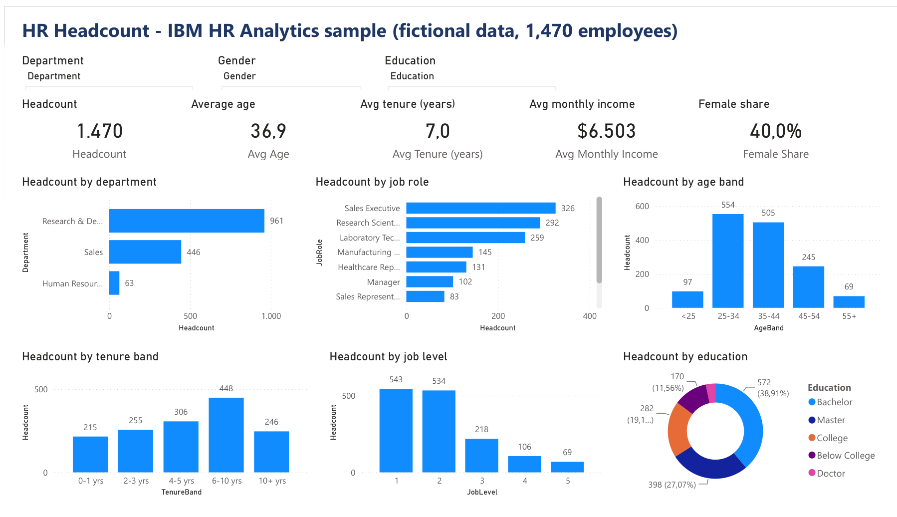
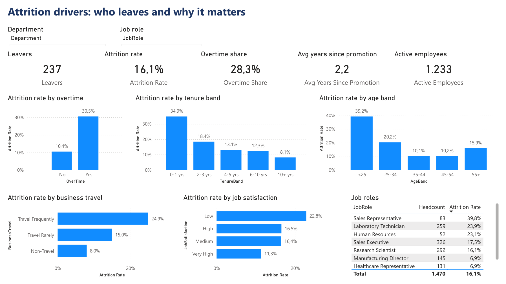

# Power BI 04 - HR Headcount

## Objective

Describe a workforce (headcount, age, tenure, pay, job levels) and identify which groups leave the company, with an attrition view that can be sliced by department, gender, education and job role.

---

## Dataset

| Field | Detail |
|---|---|
| Source | IBM HR Analytics Employee Attrition sample ([IBM/employee-attrition-aif360](https://github.com/IBM/employee-attrition-aif360)); a fictional dataset created by IBM data scientists |
| Records | 1,470 employees, 35 original fields |
| Period | Single snapshot (no hire dates) |
| Files | `data/hr_employees.csv` (labels for coded fields, age/tenure bands with sort order, `LeftFlag`) |

---

## Data Model

| Table | Grain | Notes |
|---|---|---|
| `Employees` | one row per employee | band columns use `sortByColumn` (`AgeOrder`, `TenureOrder`) so bands sort logically |

A single flat table is enough here: there are no dates or related entities in the source.

---

## Key DAX Measures

| Measure | Purpose |
|---|---|
| Headcount, Active Employees, Leavers | Counts |
| Attrition Rate | Leavers / headcount |
| Attrition Rate Overall, Attrition vs Overall (pts) | Benchmark against the whole company, ignoring filters |
| Avg Monthly Income, Avg Tenure (years), Avg Age, Female Share, Overtime Share, Avg Years Since Promotion | Workforce profile |

Measures are grouped in display folders; implicit measures are disabled so every number on the report comes from a named measure.

---

## Results Preview

### Page 1 - Headcount Overview



### Page 2 - Attrition Drivers



---

## Key Findings

1. **1,470 employees**, **237 leavers** (attrition **16.1%**); average age 36.9, average tenure 7.0 years, average monthly income $6,503, 40.0% female.
2. Overtime is the strongest single driver: **30.5%** attrition for employees who work overtime against **10.4%** for those who do not (28.3% of staff work overtime).
3. Attrition falls with tenure: **34.9%** in the first year, **8.1%** after ten years.
4. By department: Sales 20.6%, Human Resources 19.0%, Research & Development 13.8%.

All headline numbers were checked independently with pandas (`powerbi/verify_numbers.py`) and match the report.

---

## How to open

1. Install **Power BI Desktop** (built and tested with version 2.159, Nov 2026). Projects in the `.pbip` format open directly; if your build asks for it, enable *Options > Preview features > Power BI Project (.pbip) save option*.
2. Open `HR_Headcount.pbip`.
3. The CSV files are read through one Power Query parameter, **`DataFolder`**. It points to this project's `data` folder on the author's machine. Set it to your local path in *Transform data > Edit parameters* (or in `HR_Headcount.SemanticModel/definition/expressions.tmdl`).
4. Click **Refresh**. On a first open Power BI may show "calculated objects must be refreshed manually": use *Refresh now*.

---

## File Structure

```
04_hr_headcount/
├── HR_Headcount.pbip                 <- open this in Power BI Desktop
├── HR_Headcount.SemanticModel/       <- tables, relationships and measures (TMDL text files)
├── HR_Headcount.Report/              <- pages and visuals (PBIR JSON files)
├── data/                            <- CSV files read by Power Query
├── images/                          <- screenshots used in this README
└── README.md
```

---

## Limitations

- Fictional, balanced sample created for teaching; do not infer real-world HR facts from it.
- Single snapshot: attrition is a flag, so there is no time dimension for trends or survival analysis.

---

## Tools Used

Power BI Desktop (PBIP project format: TMDL semantic model + PBIR report), DAX, Power Query (M), Python/pandas for data preparation and independent verification of the headline numbers.
