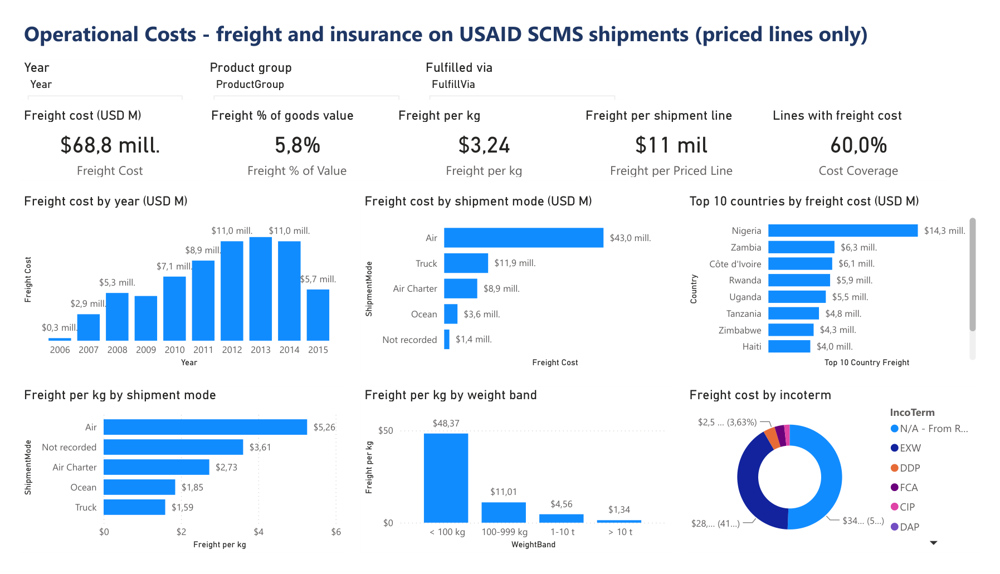
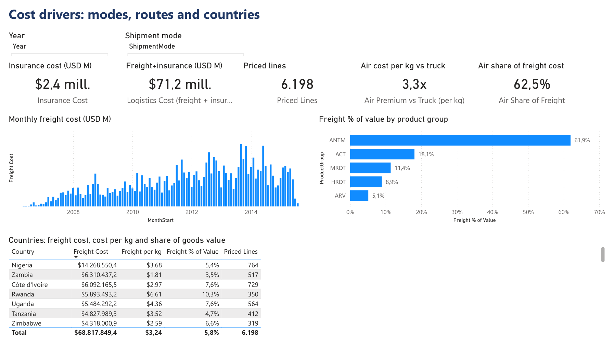

# Power BI 05 - Operational Costs

## Objective

Break down the logistics cost (freight and insurance) of a large health-supply network by year, shipment mode, weight band, country and product group, and compare cost per kilogram across modes.

---

## Dataset

| Field | Detail |
|---|---|
| Source | USAID / PEPFAR Supply Chain Shipment Pricing Data ([USAID Data](https://data.usaid.gov/HIV-AIDS/Supply-Chain-Shipment-Pricing-Data/a3rc-nmf6)); same file as ML 05 (freight regression) |
| Records | 10,324 lines, of which 6,198 (60.0%) have a numeric freight cost |
| Period | Deliveries from May 2006 to September 2015 |
| Files | `data/scms_lines.csv` (same cleaned extract as the other SCMS dashboards) |

---

## Data Model

| Table | Grain | Notes |
|---|---|---|
| `Logistics` | one row per shipment line | freight, insurance, weight, value, mode; calculated `WeightBand` (sorted by `WeightOrder`) |
| `Calendar` | one row per day | DAX calculated table, related on `DeliveredDate` |

All freight ratios use only lines with a numeric freight cost (`FreightType = "Numeric"`); `Cost Coverage` shows how much of the data that is.

---

## Key DAX Measures

| Measure | Purpose |
|---|---|
| Freight Cost, Insurance Cost, Logistics Cost (freight + insurance) | Absolute costs |
| Freight % of Value | Freight / goods value on priced lines |
| Freight per kg, Freight per Priced Line | Unit costs |
| Air Premium vs Truck (per kg) | Ratio of air to truck cost per kg |
| Cost Coverage | Share of lines that carry a numeric freight cost |
| Air Share of Freight | Share of freight cost moved by air |
| Freight YoY %, Top 10 Country Freight | Trend (single year selected) and ranking |

Measures are grouped in display folders; implicit measures are disabled so every number on the report comes from a named measure.

---

## Results Preview

### Page 1 - Cost Overview



### Page 2 - Cost Drivers



---

## Key Findings

1. Priced freight totals **$68.8M** (**5.8%** of the goods value of those lines) plus **$2.4M** of insurance; the average priced line pays **$11,103** of freight, **$3.24 per kg**.
2. Cost per kg by mode: **Air $5.26**, Air Charter $2.73, Ocean $1.85, **Truck $1.59** - air costs **3.3x** truck per kilogram, yet air carries **$43.0M (62.5%)** of freight spend. Another $1.4M sits on lines with no shipment mode recorded (shown as Not recorded).
3. Cost coverage is only **60.0%** of lines: the rest has freight included in the commodity price or referenced to another shipment.

All headline numbers were checked independently with pandas (`powerbi/verify_numbers.py`) and match the report.

---

## How to open

1. Install **Power BI Desktop** (built and tested with version 2.159, Nov 2026). Projects in the `.pbip` format open directly; if your build asks for it, enable *Options > Preview features > Power BI Project (.pbip) save option*.
2. Open `Operational_Costs.pbip`.
3. The CSV files are read through one Power Query parameter, **`DataFolder`**. It points to this project's `data` folder on the author's machine. Set it to your local path in *Transform data > Edit parameters* (or in `Operational_Costs.SemanticModel/definition/expressions.tmdl`).
4. Click **Refresh**. On a first open Power BI may show "calculated objects must be refreshed manually": use *Refresh now*.

---

## File Structure

```
05_operational_costs/
├── Operational_Costs.pbip                 <- open this in Power BI Desktop
├── Operational_Costs.SemanticModel/       <- tables, relationships and measures (TMDL text files)
├── Operational_Costs.Report/              <- pages and visuals (PBIR JSON files)
├── data/                            <- CSV files read by Power Query
├── images/                          <- screenshots used in this README
└── README.md
```

---

## Limitations

- Freight totals cover priced lines only (60% of lines), so absolute totals understate the real cost.
- Cost per kg compares different lanes and products; mode differences are descriptive, not a controlled estimate (see ML 05 for a regression that adjusts for weight).
- No handling, warehousing or labour costs are in the source.

---

## Tools Used

Power BI Desktop (PBIP project format: TMDL semantic model + PBIR report), DAX, Power Query (M), Python/pandas for data preparation and independent verification of the headline numbers.
