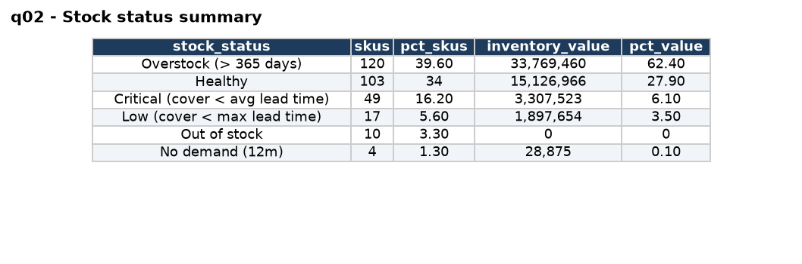
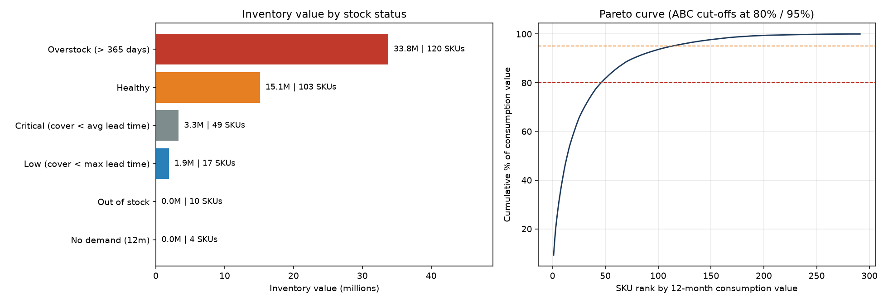
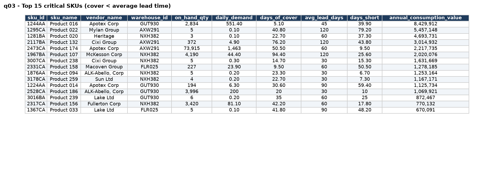
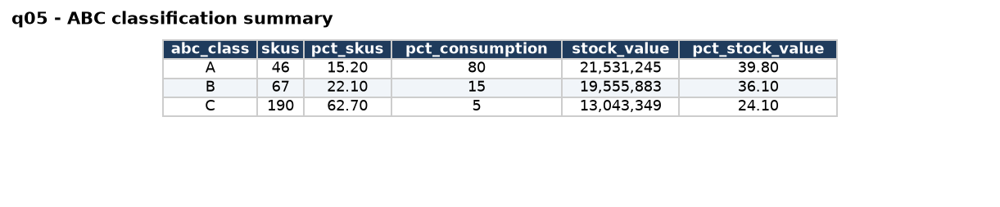
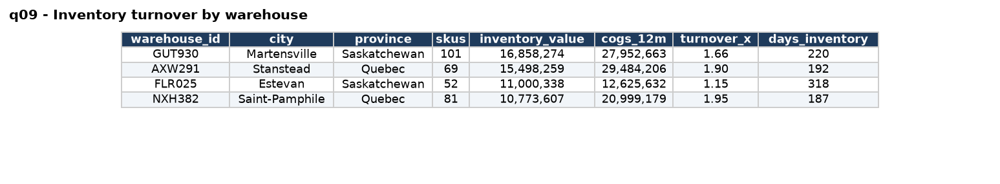

# SQL 01 - Inventory Queries: Stock Status, ABC & Reorder Risk (PostgreSQL)

## Objective

Answer the everyday questions of an inventory analyst directly in SQL: which SKUs are about to run out, which ones are over-stocked, where is the money tied up, and which items should be reordered first. The project loads the Kaizen Analytics workbook into PostgreSQL and builds reusable views plus 13 analysis queries using CTEs, window functions, joins, `FILTER` aggregates and a temporary Pareto table.

---

## Dataset

| Field | Detail |
|---|---|
| Source | Kaggle - [Dynamic Inventory Dataset - Kaizen Analytics](https://www.kaggle.com/datasets/andrewniko/dynamic-inventory-dataset-kaizen-analytics) |
| Author | andrewniko |
| Records | 33,919 sales order lines + 303 SKUs (inventory snapshot) + 4 warehouses |
| Period | 2021-01-01 to 2023-07-30 |
| File | Re-uses `python/02_inventory_optimization/dataset_kaizen analytics.xlsx` (not duplicated) |
| Database | PostgreSQL 16 (embedded `pgserver`, no installation needed) |

**Tables:** `sales`, `inventory`, `sku_items`, `warehouses` (see `01_schema.sql`).
**Views:** `v_sku_demand_12m`, `v_sku_last_sale`, `v_sku_status` (see `02_views.sql`).

---

## Methodology

- **Schema & load:** typed tables with primary/foreign keys and `CHECK` constraints; the workbook sheets are bulk-loaded with `COPY` (the `Order Number ` header has a trailing space and the 5 empty `Unnamed` columns are dropped on load).
- **Indexes:** `sales(sku_id, order_date)`, `sales(order_date)`, `sales(warehouse_id)`, `inventory(vendor_name)`, `inventory(warehouse_id)` for the SKU/date joins used by every query.
- **Demand window:** last 12 full calendar months of history (Aug-2022 to Jul-2023). Months without sales are zero-filled with `generate_series` + `CROSS JOIN LATERAL` so the standard deviation is not overstated.
- **Stock status** (days of cover = on-hand / average daily demand): *Out of stock*, *No demand (12m)*, *Critical* (cover < average lead time), *Low* (cover < maximum lead time), *Overstock* (> 365 days), otherwise *Healthy*.
- **ABC:** annual consumption value = 12-month units x unit cost; cumulative share via `SUM() OVER (ORDER BY ...)`; A = first 80%, B = next 15%, C = last 5%.
- **XYZ:** coefficient of variation of monthly demand (X <= 0.5, Y 0.5-1.0, Z > 1.0 or no demand).
- **Reorder point:** `ROP = d x LT + 1.645 x sigma_d x sqrt(LT)` (95% service level), with daily sigma derived from monthly sigma / sqrt(30).
- **Validation:** `q13` re-computes `on_hand_qty x unit_cost` and compares it with the stored `total_value`.

---

## File Structure

```
sql/01_inventory_queries/
├── 01_schema.sql                 <- Tables, keys, constraints and indexes
├── 02_views.sql                  <- v_sku_demand_12m, v_sku_last_sale, v_sku_status
├── 03_analysis.sql               <- 13 analysis queries (q01 ... q13)
├── run_inventory_queries.py      <- Loader: creates DB, loads workbook, runs the .sql files, exports results and PNGs
├── requirements.txt              <- Python dependencies
├── results/                      <- CSV with the real output of every query (+ readme_tables.md)
├── images/                       <- PNG renders of the query output
└── README.md                     <- This file
```

### How to reproduce

```bash
cd sql/01_inventory_queries
uv run --python 3.12 --with pgserver --with pandas --with openpyxl --with matplotlib --with psycopg2-binary python run_inventory_queries.py
# or: pip install -r requirements.txt && python run_inventory_queries.py
```

The script starts an embedded PostgreSQL (data directory in the OS temp folder, override with `PGDATA_DIR`), so no database has to be installed. The `.sql` files are plain PostgreSQL and also run top to bottom with `psql -f` on any PostgreSQL 13+ server.

---

## Results (real output of the queries)

### Data check (`q01`)

| metric | value |
|---|---|
| sales order lines | 33,919 |
| SKUs in inventory | 303 |
| SKUs with at least 1 sale | 290 |
| SKUs never sold | 13 |
| first order date | 2021-01-01 |
| last order date | 2023-07-30 |
| total inventory value | 54,130,478 |

### Stock status (`q02`)

| stock_status | skus | pct_skus | inventory_value | pct_value |
|---|---|---|---|---|
| Overstock (> 365 days) | 120 | 39.6 | 33,769,460 | 62.4 |
| Healthy | 103 | 34.0 | 15,126,966 | 27.9 |
| Critical (cover < avg lead time) | 49 | 16.2 | 3,307,523 | 6.1 |
| Low (cover < max lead time) | 17 | 5.6 | 1,897,654 | 3.5 |
| Out of stock | 10 | 3.3 | 0 | 0.0 |
| No demand (12m) | 4 | 1.3 | 28,875 | 0.1 |




### Reorder risk (`q03`) - critical SKUs with the highest consumption value



### ABC classification (`q05`)

| abc_class | skus | pct_skus | pct_consumption | stock_value | pct_stock_value |
|---|---|---|---|---|---|
| A | 46 | 15.2 | 80.0 | 21,531,245 | 39.8 |
| B | 67 | 22.1 | 15.0 | 19,555,883 | 36.1 |
| C | 190 | 62.7 | 5.0 | 13,043,349 | 24.1 |



### Reorder point vs stock by ABC class (`q11`)

| abc_class | skus_with_demand | at_or_below_rop | pct_at_or_below_rop | units_short_vs_rop |
|---|---|---|---|---|
| A | 46 | 27 | 58.7 | 462,527 |
| B | 67 | 18 | 26.9 | 18,525 |
| C | 177 | 44 | 24.9 | 16,608 |

### Warehouse turnover (`q09`)

| warehouse_id | city | province | skus | inventory_value | cogs_12m | turnover_x | days_inventory |
|---|---|---|---|---|---|---|---|
| GUT930 | Martensville | Saskatchewan | 101 | 16,858,274 | 27,952,663 | 1.66 | 220 |
| AXW291 | Stanstead | Quebec | 69 | 15,498,259 | 29,484,206 | 1.90 | 192 |
| FLR025 | Estevan | Saskatchewan | 52 | 11,000,338 | 12,625,632 | 1.15 | 318 |
| NXH382 | Saint-Pamphile | Quebec | 81 | 10,773,607 | 20,999,179 | 1.95 | 187 |



### Other queries (see `results/*.csv` for the complete output)

- `q06` ABC-XYZ matrix: none of the 46 class A SKUs is stable (X); 23 are Y and 23 are Z.
- `q07` dead stock: the largest idle position is Product 205 (2680BA, 618,233 tied up, last sale 2022-12-05).
- `q08` overstock: 120 SKUs, 33.8M (62.4% of total value).
- `q10` vendor concentration: Lake Ltd holds 12.5% of the stock value; the top 5 vendors hold 47.9%.
- `q12` class A SKUs at or below their reorder point, most urgent first (1244AA, 1295CA, 1281BA, ...).
- `q13` validation: 8 of 303 SKUs differ by more than 1 unit between stored and recomputed value (stored total 54,130,478 vs recomputed 54,130,469).

---

## Key Findings

1. **Stock is badly balanced:** 120 SKUs (39.6%) hold more than a year of cover and carry 62.4% of the inventory value (33.8M), while 49 SKUs (16.2%) have less cover than their average lead time.
2. **Pareto holds:** 46 SKUs (15.2%) make up 80% of the 12-month consumption value; 190 class C SKUs (62.7%) represent only 5% of consumption but hold 24.1% of the stock value.
3. **Class A is the weak point:** 27 of 46 class A SKUs (58.7%) are at or below their 95%-service reorder point. The most exposed item is 1244AA (Product 016, Apotex Corp): 5.1 days of cover against a 45-day lead time and 8.4M of annual consumption.
4. **Warehouse FLR025 (Estevan) is the slowest:** 1.15 turns/year (318 days of inventory) versus 1.95 turns (187 days) in NXH382 (Saint-Pamphile).
5. **Demand is never stable on the items that matter:** no class A SKU has a monthly CV <= 0.5, so safety stock (not just cycle stock) is needed.

---

## Limitations

- **Snapshot without date:** the inventory sheet is a single snapshot; it is assumed to be the position at the end of the sales history (2023-07-30).
- **Demand level changes in 2023:** orders per month fall from ~1,300 (2021-2022) to ~350 (2023). The 12-month window mixes both regimes, which inflates days of cover and the overstock share; a shorter window would change the percentages.
- **Warehouse in sales vs inventory:** a SKU's sales are spread over several warehouses while the inventory sheet assigns one warehouse per SKU, so warehouse-level turnover is an approximation.
- **Daily sigma is derived from monthly demand** (`sigma_monthly / sqrt(30)`), which is a simplification; lead time is treated as constant.
- **Currency is not stated** in the dataset; values are shown in the dataset's own units.
- **Dead-stock query** flags SKUs by absence of sales in 180 days; the dataset ends in July 2023 so "last sale" is relative to 2023-07-30.

---

## Tools Used

| Tool | Purpose |
|---|---|
| PostgreSQL 16 | Database engine (embedded through `pgserver`) |
| SQL (CTEs, window functions, views, indexes) | All the analysis logic |
| Python 3.12 + pandas + psycopg2 | Workbook loading (`COPY`) and result export |
| matplotlib | PNG rendering of the real query output |
