# SQL 02 - Sales Reporting: Monthly KPIs, MoM/YoY, Running Totals & Rankings on Real Retail Data (PostgreSQL)

## Objective

Build the recurring management sales reports directly in SQL on **real transaction data**: monthly revenue, month-over-month and year-over-year growth, running totals, moving averages, top-N rankings, product contribution (Pareto), revenue by country / weekday / hour, average order value, new vs returning customer revenue and cancellations. The main report uses two years of a UK retailer (1.07 million lines); a second, smaller report covers three months of Amazon India shipped orders (daily / weekly revenue, category and size mix, top SKUs). Both are modelled as small star schemas (dimensions + fact table), exposed through views and materialized views, and queried with CTEs and window functions (`LAG`, `RANK`, `DENSE_RANK`, running `SUM`, moving `AVG`, `PERCENTILE_CONT`) and conditional aggregation (`FILTER`).

> **Why this project was rebuilt.** The first version used the Kaizen Analytics workbook, but that data turned out to be synthetic (unit price = cost / 0.7 for every SKU, and orders collapsing from ~1,300 to ~350 per month in 2023), so no business conclusion on it was meaningful. This version uses two real datasets instead.

---

## Dataset

### A. Main report - UCI Online Retail II

| Field | Detail |
|---|---|
| Source | UCI Machine Learning Repository - [Online Retail II](https://archive.ics.uci.edu/dataset/502/online+retail+ii) (public, no login, CC BY 4.0) |
| Direct download | https://archive.ics.uci.edu/static/public/502/online+retail+ii.zip (45 MB) |
| Records | 1,067,371 transaction lines (two sheets: 2009-2010 and 2010-2011) |
| Period | 2009-12-01 to 2011-12-09 |
| Business | UK-based online retailer of giftware, many customers are wholesalers; amounts in GBP |
| File | **Not committed.** `run_sales_reporting.py` downloads and converts it into `data/raw/`, which is git-ignored (`**/data/raw/`) |

### B. Second report - Amazon India order lines

| Field | Detail |
|---|---|
| Source | Kaggle - [Amazon Sale Report](https://www.kaggle.com/datasets/thedevastator/unlock-profits-with-e-commerce-sales-data) (author: thedevastator), cleaned in `excel/01_inventory_control/01_inventory_control.xlsx`, sheet `Clean Data` (re-used, not duplicated) |
| Records | 107,160 shipped order lines, 7,082 SKUs, 9 categories, 11 sizes |
| Period | 2022-03-31 to 2022-06-29 (91 days, **after the date repair below**) |
| Currency | INR |
| Fields | `SKU`, `Category`, `Date`, `Size`, `Qty`, `Amount` |

**Data bug in the workbook (repaired here).** In the `Clean Data` sheet day and month are swapped for every date whose stored day is <= 12 (the text `MM-DD-YY` was read with a day-first locale), so 31 March - 29 June appears spread over January - December 2022. The loader stores the date exactly as found (`raw_orders.stored_date`) and **the repair is done in SQL** (`02_model.sql`): `CASE WHEN day <= 12 THEN make_date(year, day, month) ELSE date END`. This is the same repair as `excel/01_inventory_control/verify_xyz.py`. Query `a01` shows the effect and `a13` validates it.

---

## Methodology

### Data treatment - Online Retail II (`02_model.sql`)

Every raw line is kept in `fact_lines` and tagged with a `line_type`; nothing is dropped silently (`q01`). Rules, first match wins:

| line_type | Rule | What it is | In revenue? |
|---|---|---|---|
| `ADJUSTMENT` | invoice starts with `A` | bad-debt adjustments | no |
| `NON_PRODUCT` | stock code does not start with 5 digits (`POST`, `DOT`, `M`, `D`, `S`, `C2`, `BANK CHARGES`, `AMAZONFEE`, `ADJUST`, `CRUK`, gift vouchers...) | postage, fees, discounts, manual entries (`q02`) | no |
| `CANCELLATION` | invoice starts with `C` | credit notes, negative quantity | no - reported separately |
| `INVALID` | quantity <= 0 or unit price <= 0 | write-offs, damaged / lost stock, free items | no |
| `SALE` | everything else | valid product sale | **yes** |

- **Revenue** in every report = gross revenue of `SALE` lines (quantity x unit price). **Net revenue** = `SALE` + `CANCELLATION` (shown in `q03`, `q05`, `q18`). Cancellations are booked in the month of the credit note, not of the original sale, so net figures are shown next to gross ones instead of replacing them.
- **Guest checkouts** (no customer id) are real sales and stay in revenue; they are excluded only from customer-level logic (new vs returning, `q17`, where they are their own column).
- Stock codes are upper-cased and trimmed (the raw file mixes `15056bl` and `15056BL`); the product description is the most frequent one for the code.
- **Partial periods** are not compared: the data ends on 2011-12-09, so growth rates are `NULL` for December 2011, Q4-2011 and FY2012; Q4-2009 holds only December. Yearly reporting uses a **Dec-Nov business year** (FY2010 = 2009-12-01 .. 2010-11-30, FY2011 = 2010-12-01 .. 2011-11-30), because those are the only two full 12-month windows in the data.

### Model, views and indexes

- **Star schema, schema `retail`:** fact `fact_lines`; dimensions `dim_date` (generated with `generate_series`, with month/quarter start, weekday and business year), `dim_product`, `dim_country`, `dim_customer`; primary / foreign keys and `CHECK` constraints.
- **Star schema, schema `amazon`:** fact `fact_order_lines` (keeps repaired `order_date` and original `stored_date`); dimensions `dim_date`, `dim_product` (SKU, style code = SKU prefix before the first hyphen), `dim_category`, `dim_size` (natural size order).
- **Views:** `retail.v_sales_enriched`, `amazon.v_orders_enriched`.
- **Materialized views (with unique indexes):** `retail.mv_monthly_revenue`, `retail.mv_product_revenue`, `amazon.mv_daily_sales`.
- **Indexes:** on date, `(line_type, date)`, product, country, `(customer_id, date)` and invoice for the retail fact; on date, SKU and size for the Amazon fact.

### Reports

- **Time series:** MoM with `LAG`, YoY with `LAG(..., 12)` (months) and `LAG() OVER (PARTITION BY quarter ORDER BY year)` (quarters), calendar-YTD running total with `SUM() OVER (PARTITION BY year ORDER BY month)`, 3-month moving average with `ROWS BETWEEN 2 PRECEDING AND CURRENT ROW`, like-for-like windows (Jan-Nov, Dec 1-9).
- **Rankings:** top products with `RANK` (revenue) + `DENSE_RANK` (units) + net-revenue rank, top 5 per business year with `RANK() OVER (PARTITION BY fy)` and the previous-year rank, top countries and country rank movement.
- **Product contribution:** cumulative share with `SUM() OVER (ORDER BY revenue DESC)`, ABC classes (A = first 80% of revenue, B = next 15%, C = last 5%) and the concentration curve.
- **Mix:** weekday, hour, average vs median order value (`PERCENTILE_CONT`), new vs returning vs guest revenue (`LEFT JOIN dim_customer` + `CASE`), cancellations and the biggest single lines (`LATERAL` join to their cancellations).
- **Amazon:** daily revenue with day-over-day and 7-day moving average, weekly and monthly growth on **average daily revenue** (the first and last weeks / months are partial), category / size mix and a `FILTER` pivot, top SKUs and styles, concentration.
- **Reconciliation:** `q20` (retail) and `a13` (Amazon) check that fact table, views, materialized views and every grouping return the same totals, and that no sale line has non-positive quantity / price or a non-product code.

---

## File Structure

```
sql/02_sales_reporting/
├── 01_schema.sql              <- Schemas retail + amazon: raw tables, dimensions, fact tables, constraints
├── 02_model.sql               <- line classification, star-schema load, Amazon date repair, indexes
├── 03_views.sql               <- enriched views + materialized views
├── 04_reports_retail.sql      <- 21 report queries on Online Retail II (q01 ... q21)
├── 05_reports_amazon.sql      <- 13 report queries on Amazon India (a01 ... a13)
├── run_sales_reporting.py     <- Loader: downloads data, creates the DB, runs the .sql files, exports CSV + PNG
├── requirements.txt           <- Python dependencies
├── results/                   <- CSV with the real output of every query (+ readme_tables.md)
├── images/                    <- PNG renders of the query output and two dashboards
└── README.md                  <- This file
```

### How to reproduce

```bash
cd sql/02_sales_reporting
uv run --python 3.12 --with pgserver --with pandas --with python-calamine --with matplotlib --with psycopg2-binary python run_sales_reporting.py
# or: pip install -r requirements.txt && python run_sales_reporting.py
```

The first run downloads the 45 MB zip and converts the Excel file to `data/raw/online_retail_II.csv` (about 1 minute). The script then creates (or recreates) a database called `sales_reporting` inside an embedded PostgreSQL 16 (`pgserver`; set the `PGDATA_DIR` environment variable to choose its data directory), loads both sources with `COPY`, builds the model and writes every result to `results/` and `images/`. Measured runs with the CSV already cached on a slow laptop: 2 to 5.5 minutes in total depending on machine load (best run: raw load 20 s, model build 55 s, views 12 s, 34 queries 30 s, images 8 s; slowest run: 334 s). The `.sql` files also run top to bottom with `psql -f` on any PostgreSQL 13+ once the two raw tables (`retail.raw_transactions`, `amazon.raw_orders`) are loaded. Cold imports of the Python packages can add several minutes on the first run.

---

## Results Preview (real output of the queries)

All numbers below are copied from `results/*.csv`. Retail amounts are GBP, Amazon amounts are INR.

### Online Retail II

#### Data funnel (`q01`) and headline KPIs (`q03`)

| line_type | lines | invoices | amount |
|---|---|---|---|
| SALE | 1,036,877 | 39,516 | 20,108,995 |
| CANCELLATION | 18,285 | 7,405 | -726,519 |
| INVALID | 6,116 | 5,295 | 0 |
| NON_PRODUCT | 6,087 | 5,518 | 52,389 |
| ADJUSTMENT | 6 | 6 | -147,614 |

| first_date | last_date | gross_revenue | cancellations | net_revenue | cancellation_pct | orders | units | avg_order_value | products_sold | identified_customers | guest_revenue_pct |
|---|---|---|---|---|---|---|---|---|---|---|---|
| 2009-12-01 | 2011-12-09 | 20,108,995 | -726,519 | 19,382,476 | 3.61 | 39,516 | 11,402,383 | 508.88 | 4,707 | 5,852 | 13.30 |

#### Revenue per business year and YoY (`q04`) / like-for-like (`q07`)

| fy | trading_days | orders | customers | revenue | avg_order_value | yoy_pct |
|---|---|---|---|---|---|---|
| 2010 (Dec-09 .. Nov-10) | 299 | 19,743 | 4,239 | 9,428,750 | 477.57 | - |
| 2011 (Dec-10 .. Nov-11) | 297 | 18,957 | 4,293 | 10,064,755 | 530.93 | 6.7 |
| 2012 (1-9 Dec 2011, partial) | 8 | 816 | 614 | 615,490 | 754.28 | n/a |

| period | rev_2009 | rev_2010 | rev_2011 | yoy_2010_pct | yoy_2011_pct |
|---|---|---|---|---|---|
| Jan-Nov (11 full months) | - | 8,627,811 | 8,877,679 | - | 2.9 |
| Dec 1-9 | 392,542 | 818,421 | 615,490 | 108.5 | -24.8 |


#### Monthly revenue with MoM, YoY, YTD and moving average (`q05`)

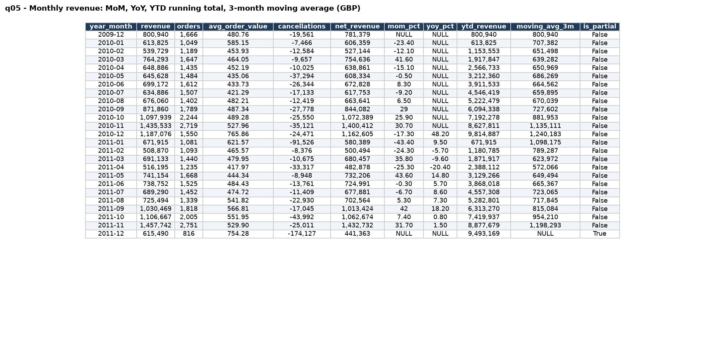

Full 25-month output: `results/q05_monthly_mom.csv`.

#### Quarterly YoY (`q06`)

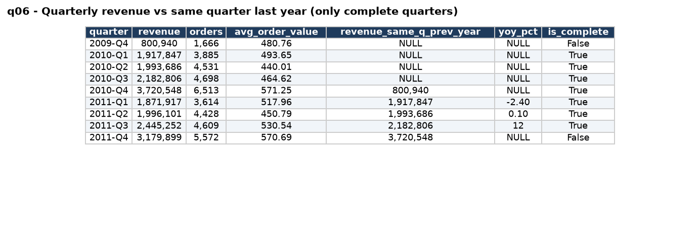

#### Top products (`q08`), product contribution (`q10`, `q11`)

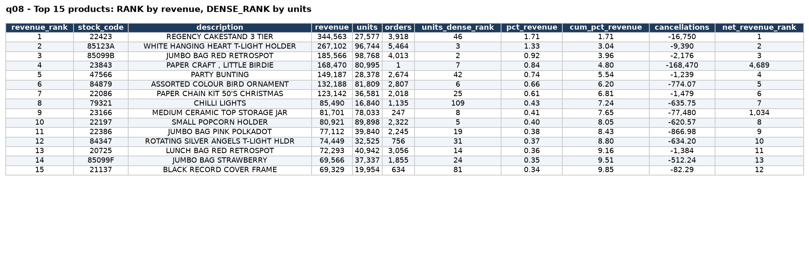

| abc_class | products | pct_products | revenue | pct_revenue |
|---|---|---|---|---|
| A | 1,025 | 21.8 | 16,088,659 | 80.0 |
| B | 1,260 | 26.8 | 3,015,898 | 15.0 |
| C | 2,422 | 51.5 | 1,004,439 | 5.0 |

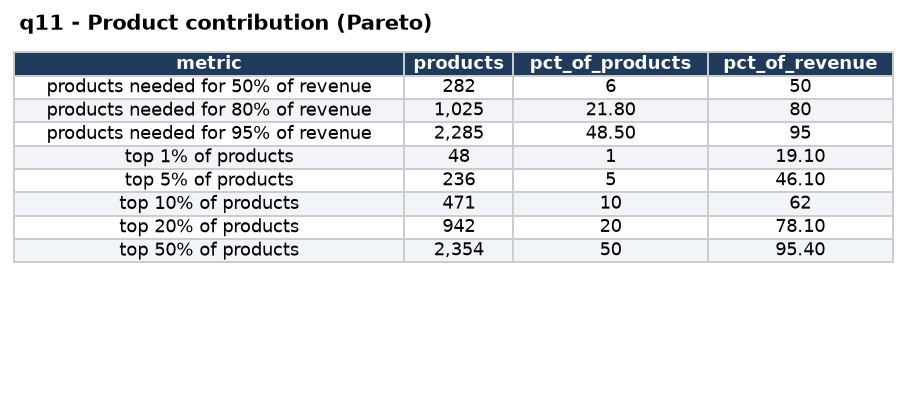

#### Top countries (`q12`) and the biggest single lines (`q19`)

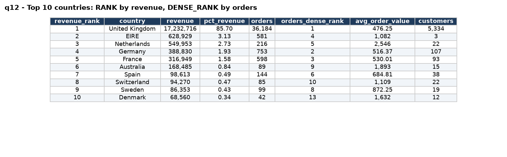
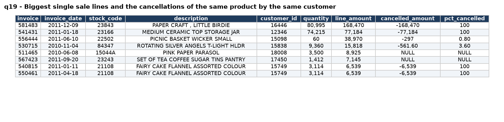

#### Retail dashboard rendered from the query output

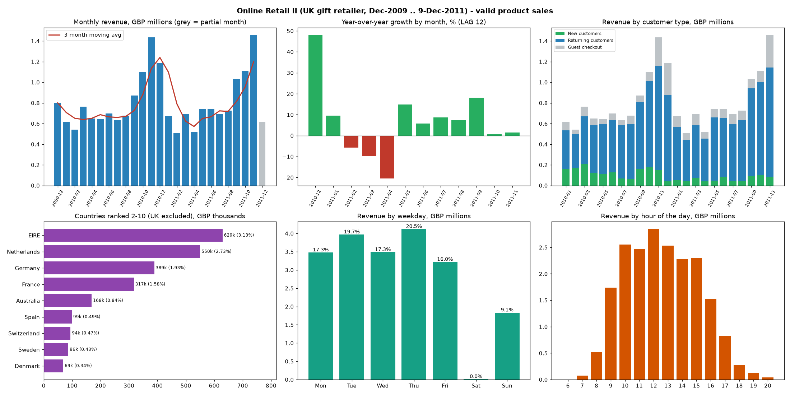

### Amazon India

#### Date repair (`a01`) and headline (`a02`)

| version | first_date | last_date | distinct_days | distinct_months | lines_swapped |
|---|---|---|---|---|---|
| as stored in the workbook | 2022-01-04 | 2022-12-06 | 91 | 12 | 0 |
| repaired (day <= 12: day and month swapped) | 2022-03-31 | 2022-06-29 | 91 | 4 | 42,401 |

| order_lines | units | revenue_inr | avg_revenue_per_line | avg_daily_revenue | skus | categories |
|---|---|---|---|---|---|---|
| 107,160 | 107,569 | 71,050,985 | 663.04 | 780,780 | 7,082 | 9 |

#### Weekly growth (`a04`), monthly (`a05`)

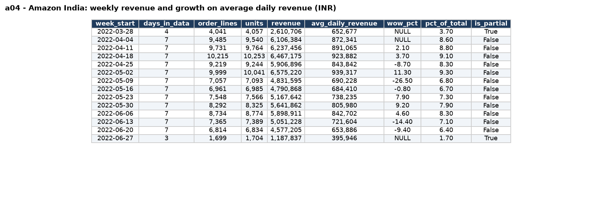

| year_month | days_in_data | revenue | avg_daily_revenue | daily_avg_mom_pct |
|---|---|---|---|---|
| 2022-03 | 1 | 94,810 | 94,810 | - |
| 2022-04 | 30 | 26,234,121 | 874,471 | - |
| 2022-05 | 31 | 23,948,113 | 772,520 | -11.7 |
| 2022-06 | 29 | 20,773,941 | 716,343 | -7.3 |

#### Category mix (`a06`) and top SKUs (`a09`)

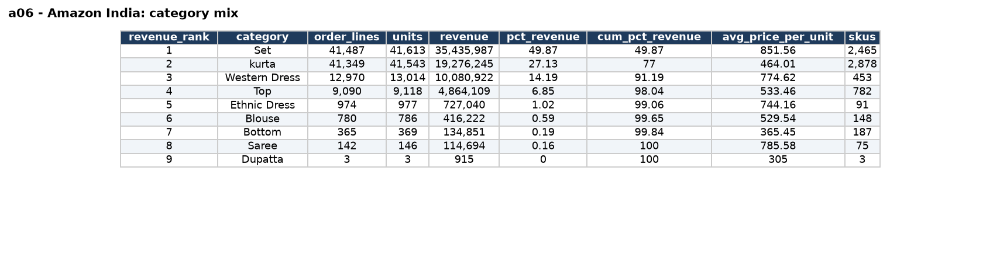
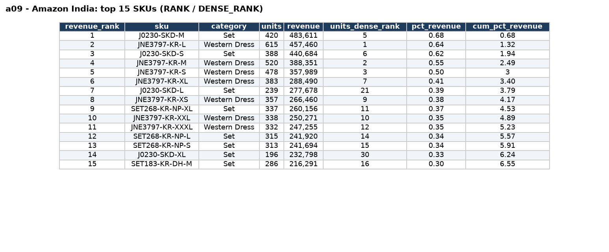

#### Amazon dashboard rendered from the query output

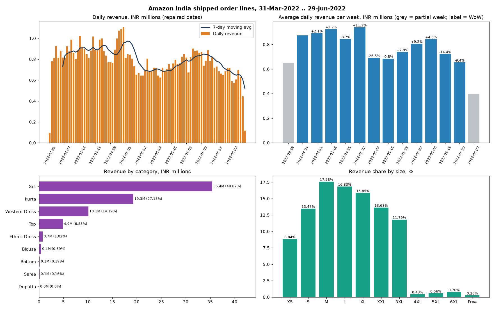

### Other queries (see `results/*.csv`)

- `q02` non-product codes: `M` (manual), `AMAZONFEE`, `DOT` (dotcom postage) and `POST` are the largest by absolute amount.
- `q09` top 5 products per business year with the previous-year rank; `q13` country revenue and rank movement FY2010 -> FY2011.
- `q14` weekday, `q15` hour of day, `q16` average vs median order value per month, `q17` new vs returning vs guest revenue, `q18` monthly cancellations.
- `q20` / `a13` reconciliation: every route to the same revenue gives 20,108,995 (retail) and 71,050,985 (Amazon); all checks `ok = True`.
- `a03` daily revenue, `a07` size mix, `a08` size mix inside the 4 biggest categories, `a10` top styles, `a11` SKU concentration, `a12` weekday.

---

## Key Findings

### Online Retail II (2 years, GBP)

1. **Modest growth, helped by December:** FY2011 revenue is 10,064,755 vs 9,428,750 in FY2010 (**+6.7%**). On a like-for-like Jan-Nov basis the growth is only **+2.9%** (8,877,679 vs 8,627,811); the difference comes from December 2010, which was +48.2% above December 2009 (1,187,076 vs 800,940).
2. **Strong seasonality:** September-November brings 36.1% of FY2010 revenue and 35.7% of FY2011. November is the peak in both years (1,435,533 in 2010 and 1,457,742 in 2011, +1.5% YoY) and February 2011 the low (508,870).
3. **The year-over-year picture is mixed:** 9 of the 12 months with a valid YoY are positive; February-April 2011 were below the same months of 2010 (-5.7%, -9.6%, -20.4%), while September 2011 was +18.2%. By quarter, Q1-2011 is -2.4%, Q2 +0.1% and Q3 +12.0%; Q4 cannot be compared (Q4-2009 contains only December, Q4-2011 stops on 9 December).
4. **The partial December 2011 must not be read as a collapse:** 1-9 December 2011 gives 615,490 against 818,421 for the same days of 2010 (-24.8%), but that window includes one 168,470 sale line that the customer cancelled in full on the same day (`q19`).
5. **Gross revenue contains a few big lines that were cancelled in full:** 74,215 units of a ceramic storage jar (77,184 on 2011-01-18) and 80,995 units of a paper craft item (168,470 on 2011-12-09) were each credited back in full the same day. They explain most of the cancellations of January 2011 (13.62% of that month's gross revenue) and December 2011 (28.29%), and "PAPER CRAFT, LITTLE BIRDIE" is #4 by gross revenue but #4,689 by net revenue (`q08`). Overall, cancellations are 3.61% of gross revenue (726,519).
6. **Revenue is concentrated in a minority of products:** 1,025 of 4,707 products (21.8%) generate 80% of revenue and 282 products (6.0%) generate 50%; the top 1% (48 products) gives 19.1%. The best seller is REGENCY CAKESTAND 3 TIER with 344,563 (1.71%); the tail of 2,422 products (51.5% of the catalogue) is only 5% of revenue.
7. **The UK is 85.70% of revenue**, followed by EIRE (3.13%), Netherlands (2.73%), Germany (1.93%) and France (1.58%). Export markets moved unevenly in FY2011: Australia +367.4% and Japan 5,608 -> 41,531, while EIRE fell 23.7% and Sweden 26.1%. Several export markets have few buyers (EIRE: 3 customers; Netherlands: 22 customers with an average order of 2,546 vs 476.25 in the UK), so their swings follow one or two wholesalers.
8. **Trading pattern:** Thursday (20.5%) and Tuesday (19.7%) are the strongest days, Sunday is 9.1% and there is effectively no Saturday trading (1 day with 30 orders). Hours 10:00-15:59 produce about 74% of revenue, with the 12:00 hour the busiest (14.1%).
9. **Order value is skewed:** the average order is 508.88 but monthly medians stay between 282.45 and 350.17, i.e. a minority of large wholesale baskets pulls the mean up. December 2010 had fewer orders than November (1,550 vs 2,719) but much larger ones (average 765.86, +59.3% YoY; 40.8 lines per order).
10. **Returning customers drive revenue:** from January 2010 to November 2011, 74.8% of revenue comes from returning customers, 12.1% from new ones and 13.1% from guest checkouts (monthly returning share 60.0%-82.7%). The new-customer share falls from about 26-31% in early 2010 to 5.5-11.2% in the last six months of the data, but early 2010 is inflated because customers already active before December 2009 look "new" (left-censoring).

### Amazon India (3 months, INR)

1. **The date repair changes the story:** as stored, the 91 days look like 12 months (2022-01-04 .. 2022-12-06); after swapping day and month for 42,401 lines they form one continuous quarter (2022-03-31 .. 2022-06-29, 91 days, no gaps).
2. **71,050,985 INR from 107,160 lines** (107,569 units; almost every line is one unit), 780,780 INR per day and 663.04 per line.
3. **Demand weakened during the quarter:** average daily revenue was 874,471 in April, 772,520 in May (-11.7%) and 716,343 in June (-7.3%). Among complete weeks the best is the week of 2 May (939,317 per day) and the worst the week of 20 June (653,886); the biggest weekly drop is -26.5% in the week of 9 May right after a +11.3% peak.
4. **Two categories are three quarters of revenue:** Set 49.87% and kurta 27.13%; the four largest categories (adding Western Dress 14.19% and Top 6.85%) give 98.04%. Set and kurta have almost the same number of lines (41,487 vs 41,349) but a Set sells for 851.56 per unit vs 464.01.
5. **Mid sizes dominate:** M 17.58%, L 16.83%, XL 15.85% of revenue; 4XL-6XL together are only 1.75% but have the highest price per unit (about 817-826). Sets skew small (XS+S = 25.5% of units vs 17.5% for kurta).
6. **Long tail at SKU level:** 593 of 7,082 SKUs (8.4%) make 50% of revenue and 1,968 (27.8%) make 80%. Because each SKU is a style + size, the best style JNE3797 (14 SKU variants) adds up to 2,569,843 (3.62%) while its best single SKU is JNE3797-KR-L.
7. **Weekdays are fairly flat:** 13.3% (Thursday) to 15.4% (Sunday) of revenue.

---

## Limitations

- **One UK business:** Online Retail II is a single UK gift retailer with many wholesale customers; its seasonality, weekday pattern and country mix do not generalise to other retailers.
- **Gross vs net:** all headline revenue is gross of cancellations; net figures are shown next to it (`q03`, `q05`, `q18`). Credit notes carry no reference to the original invoice, so a cancellation is booked in the month it was issued, and a few huge sale-and-cancel pairs (`q19`) distort gross figures in the month they happen.
- **Short history:** only two years exist (Dec-2009 .. 9-Dec-2011), so there is exactly one valid year-over-year comparison per month (Dec-2010 .. Nov-2011), no calendar-year comparison and no seasonal model; Q4-2011 and December 2011 are incomplete.
- **Business-year definition:** yearly YoY uses Dec-Nov years because those are the only full 12-month windows; calendar-year totals would mix a one-month 2009 and a partial 2011.
- **New vs returning** is relative to the start of the data: customers who had already bought before December 2009 are counted as new in their first observed month. Guest checkouts cannot be tracked and are shown separately.
- **Possible duplicates:** the raw file contains fully identical lines (same invoice, product, quantity, timestamp, price, customer): 32,907 distinct repeated lines with 34,335 surplus copies (`q21`, 3.22% of raw lines). They cannot be told apart from genuine repeated scans, so they are kept in revenue.
- **Amazon sample covers only 3 months** (91 days), so there is **no year-over-year** and no seasonality in that section; growth is week-over-week and month-over-month on average daily revenue. The first day (31 Mar: 152 lines) and the last two days (28 Jun: 641, 29 Jun: 170 lines vs roughly 1,200-1,600 per April day, `a03`) look truncated, which drags March and June down.
- **Amazon file is pre-filtered:** it holds only shipped lines of the original Kaggle file (107,160 of about 129,000), so cancellations and returns cannot be analysed there. The date repair is documented and verifiable (`a01`, `a13`) but relies on the observation that every swapped date has a stored day <= 12.
- **SKU = style + size (+ colour):** SKU-level rankings are fragmented; `a10` groups by style code (prefix before the first hyphen), a heuristic that is not an official product key.
- **Currencies differ** (GBP vs INR) and the two sources are different businesses and periods, so they are reported side by side, never combined.

---

## Tools Used

| Tool | Purpose |
|---|---|
| PostgreSQL 16 | Database engine (embedded through `pgserver`) |
| SQL (CTEs, window functions, `FILTER`, `PERCENTILE_CONT`, materialized views, indexes) | All reporting logic, classification of cancellations / non-product codes and the Amazon date repair |
| Python 3.12 + pandas + python-calamine + psycopg2 | Download, Excel reading, loading with `COPY`, export of results |
| matplotlib | PNG renders of the real query output |
