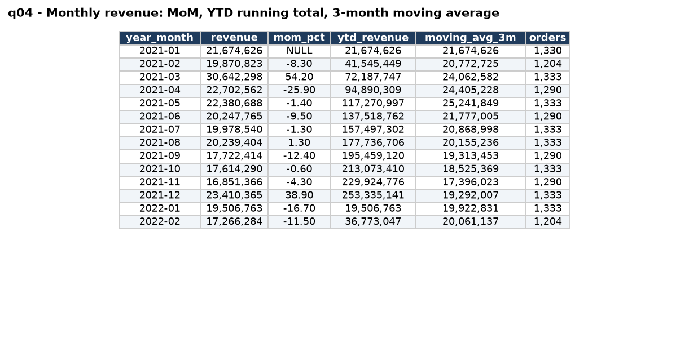
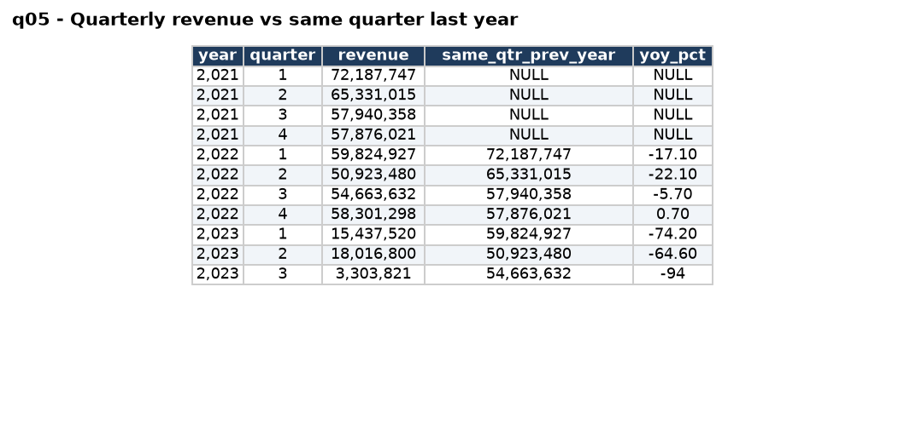
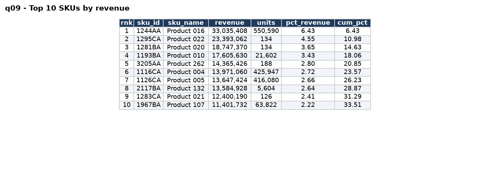
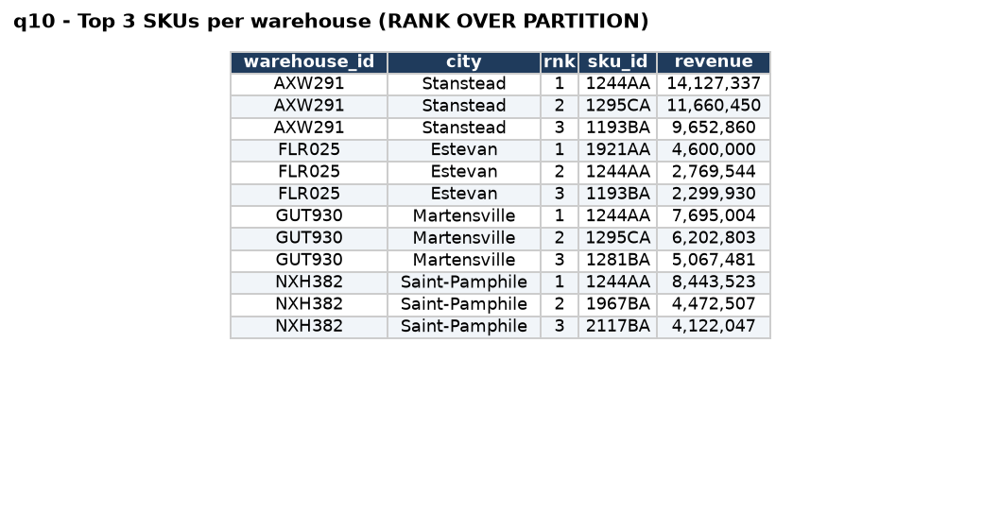
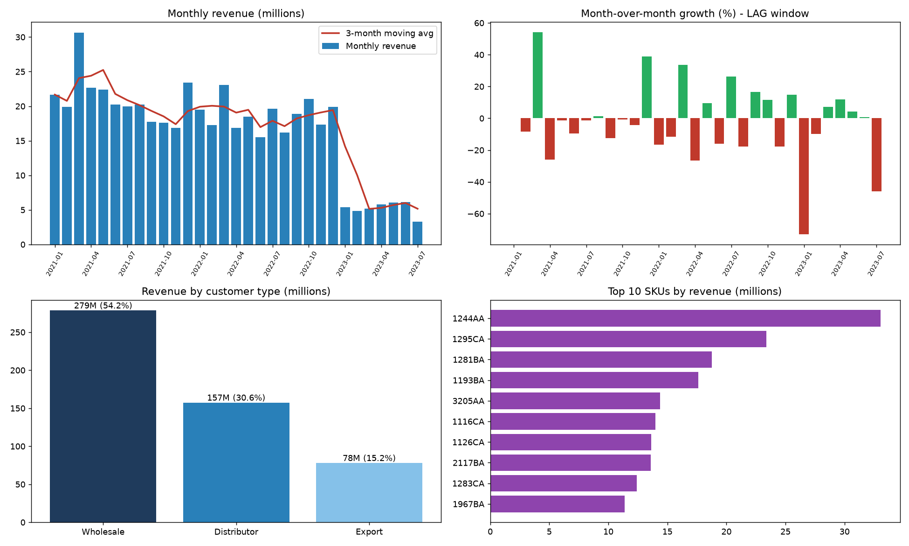

# SQL 02 - Sales Reporting: Monthly KPIs, MoM/YoY, Running Totals & Rankings (PostgreSQL)

## Objective

Build the recurring management sales reports directly in SQL: monthly/quarterly/yearly revenue, month-over-month and year-over-year growth, running totals, moving averages, revenue mix by customer type and warehouse, and top-N rankings per group. The project models the sales history as a small star schema (fact table + dimensions), exposes it through views, and produces 14 reports with CTEs, window functions (`LAG`, `RANK`, running `SUM`, moving `AVG`), conditional aggregation and a materialized view.

---

## Dataset

| Field | Detail |
|---|---|
| Source | Kaggle - [Dynamic Inventory Dataset - Kaizen Analytics](https://www.kaggle.com/datasets/andrewniko/dynamic-inventory-dataset-kaizen-analytics) (sheets `Sales Data`, `SKU Items`, `Warehouse`) |
| Author | andrewniko |
| Records | 33,919 sales order lines, 290 SKUs sold, 4 warehouses, 3 customer types |
| Period | 2021-01-01 to 2023-07-30 |
| File | Re-uses `python/02_inventory_optimization/dataset_kaizen analytics.xlsx` (not duplicated) |
| Database | PostgreSQL 16 (embedded `pgserver`) |

> **Why not the Amazon dataset?** The Amazon India files in `python/01_sales_eda/` are a *product catalogue* (one row per product, prices and ratings, no order dates, no quantities), so they cannot support time-series reporting. They are used in `sql/05_data_cleaning` instead.

---

## Methodology

- **Model:** fact table `sales` + dimensions `sku_items`, `warehouses` and a generated calendar `dim_date` (`generate_series`), with primary/foreign keys and `CHECK` constraints.
- **Views:** `v_sales_enriched` (fact joined to all dimensions) and `mv_monthly_sales` (materialized monthly KPIs with a unique index).
- **Indexes:** on `order_date`, `sku_id`, `(warehouse_id, order_date)` and `customer_type`.
- **Time series:** MoM growth with `LAG`, YTD running total with `SUM() OVER (PARTITION BY year ORDER BY ...)`, 3-month moving average with `ROWS BETWEEN 2 PRECEDING AND CURRENT ROW`, YoY by quarter with `LAG() OVER (PARTITION BY quarter ORDER BY year)`.
- **Mix & ranking:** share of total with `SUM(SUM()) OVER ()`, top-10 SKUs with `RANK`, top-3 SKUs per warehouse with `RANK() OVER (PARTITION BY ...)`, pivot by `FILTER`, concentration (SKUs needed for 50/80/95% of revenue).
- **Cohorts:** SKUs grouped by first-sale quarter and checked for activity in the last 12 months.
- **Reconciliation:** base table, enriched view and monthly materialized view must give the same revenue; stored revenue is checked against `qty x price`.

---

## File Structure

```
sql/02_sales_reporting/
├── 01_schema.sql              <- Tables, calendar dimension, constraints, indexes
├── 02_views.sql               <- v_sales_enriched + mv_monthly_sales (materialized)
├── 03_reports.sql             <- 14 report queries (q01 ... q14)
├── run_sales_reporting.py     <- Loader: creates DB, loads data, runs the .sql files, exports CSV + PNG
├── requirements.txt           <- Python dependencies
├── results/                   <- CSV with the real output of every query (+ readme_tables.md)
├── images/                    <- PNG renders of the query output
└── README.md                  <- This file
```

### How to reproduce

```bash
cd sql/02_sales_reporting
uv run --python 3.12 --with pgserver --with pandas --with openpyxl --with matplotlib --with psycopg2-binary python run_sales_reporting.py
# or: pip install -r requirements.txt && python run_sales_reporting.py
```

The `.sql` files also run top to bottom with `psql -f` on any PostgreSQL 13+ after loading the data (the Python script does the loading with `COPY`).

---

## Results (real output of the queries)

### Headline KPIs (`q01`)

| orders | units | revenue | avg_order_value | skus_sold | first_date | last_date |
|---|---|---|---|---|---|---|
| 33,919 | 14,679,912 | 513,806,619 | 15,148 | 290 | 2021-01-01 | 2023-07-30 |

### Yearly revenue and YoY (`q02`) / like-for-like Jan-Jul (`q03`)

| year | orders | revenue | yoy_pct | revenue_jan_jul | yoy_jan_jul_pct |
|---|---|---|---|---|---|
| 2021 | 15,692 | 253,335,141 | - | 157,497,302 | - |
| 2022 | 15,695 | 223,713,337 | -11.7 | 130,383,348 | -17.2 |
| 2023 (Jan-Jul) | 2,532 | 36,758,141 | -83.6 (partial year) | 36,758,141 | -71.8 |


### Monthly revenue with MoM, YTD and moving average (`q04`)



Full 31-month output: `results/q04_monthly_mom.csv`.

### Quarterly YoY (`q05`)



### Revenue by customer type (`q06`)

| customer_type | orders | revenue | pct_revenue | avg_order_value | revenue_per_unit |
|---|---|---|---|---|---|
| Wholesale | 18,193 | 278,536,195 | 54.2 | 15,310 | 35.20 |
| Distributor | 10,651 | 157,335,042 | 30.6 | 14,772 | 33.47 |
| Export | 5,075 | 77,935,382 | 15.2 | 15,357 | 37.71 |

### Revenue by warehouse (`q08`)

| warehouse_id | city | province | orders | revenue | pct_revenue | avg_order_value |
|---|---|---|---|---|---|---|
| AXW291 | Stanstead | Quebec | 15,938 | 237,912,192 | 46.3 | 14,927 |
| GUT930 | Martensville | Saskatchewan | 7,861 | 114,496,446 | 22.3 | 14,565 |
| NXH382 | Saint-Pamphile | Quebec | 6,657 | 104,433,140 | 20.3 | 15,688 |
| FLR025 | Estevan | Saskatchewan | 3,463 | 56,964,841 | 11.1 | 16,450 |

### Top 10 SKUs (`q09`) and top 3 per warehouse (`q10`)




### Dashboard rendered from the query output



### Other queries (see `results/*.csv`)

- `q07` revenue by year x customer type (pivot): Export fell from 42,650,437 (2021) to 28,730,167 (2022), -32.6%.
- `q11` weekday: orders are evenly spread across the 7 days (4,832-4,875 orders per weekday), revenue share 13.5%-15.5% per day.
- `q12` SKU cohorts: 234 SKUs first sold in 2021-Q1, 42 in 2021-Q2, 12 in 2021-Q3, 1 in 2022-Q1 and 1 in 2023-Q1; all 290 are still selling in the last 12 months.
- `q13` concentration: 19 SKUs generate 50% of revenue, 57 generate 80%, 130 generate 95% (of 290).
- `q14` reconciliation: base table, enriched view and monthly materialized view all return 513,806,619; 0 lines differ from `qty x unit price` by more than 1.

---

## Key Findings

1. **Revenue is shrinking:** 2022 revenue was 11.7% below 2021 (223.7M vs 253.3M), and the like-for-like Jan-Jul comparison shows -17.2% (2022 vs 2021) and -71.8% (2023 vs 2022).
2. **2023 is a different regime:** from January 2023 orders per month drop from ~1,300 to ~350 and monthly revenue from ~20M to ~5-6M; orders and revenue fall by similar proportions (Jan-Jul 2023 vs Jan-Jul 2022: 2,532 vs 9,116 orders, -72%), so the drop is order volume rather than order size (average order value stays near 15K).
3. **Wholesale is the core channel:** 54.2% of revenue; Export is the smallest (15.2%) and the one that fell fastest in 2022 (-32.6%).
4. **Stanstead (AXW291) ships almost half of the revenue** (46.3%) with 15,938 orders; Estevan (FLR025) is the smallest at 11.1% but has the highest average order value (16,450).
5. **Revenue is concentrated in few SKUs:** 19 of 290 SKUs (6.6%) give 50% of revenue; SKU 1244AA (Product 016) alone is 6.43%.
6. **Peaks appear in March and December** (MoM +54.2% in Mar-2021, +38.9% in Dec-2021, +33.5% in Mar-2022).

---

## Limitations

- **Looks synthetic in places:** the order count is almost constant per calendar day through 2021-2022 and all weekdays have virtually the same number of orders, so weekday and seasonality conclusions should be taken with caution.
- **2023 is partial (Jan-Jul)** and has a sharp volume drop; YoY for 2023 is only meaningful on a like-for-like basis (q03/q05).
- **Revenue only:** the dataset has no cost of goods in the sales sheet, so margin reports are not included (cost per SKU lives in the inventory sheet and is used in the inventory projects).
- **Currency not stated** in the dataset; values are shown in the dataset's own units.
- **Customers are anonymised** to a type (Wholesale / Distributor / Export); customer-level analysis is covered in `sql/03_customer_analysis`.

---

## Tools Used

| Tool | Purpose |
|---|---|
| PostgreSQL 16 | Database engine (embedded through `pgserver`) |
| SQL (CTEs, window functions, materialized view, indexes) | All reporting logic |
| Python 3.12 + pandas + psycopg2 | Workbook loading (`COPY`) and result export |
| matplotlib | PNG rendering of the real query output |
