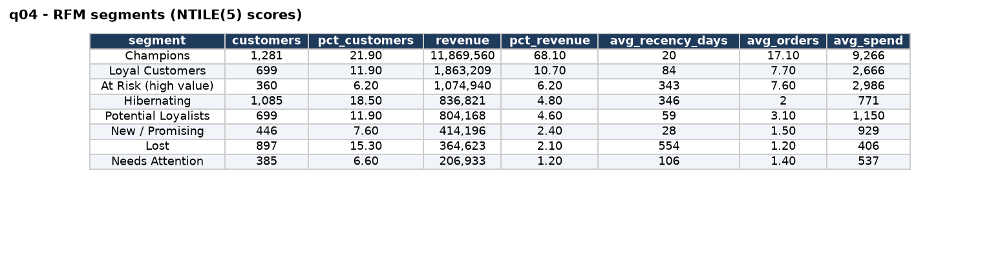
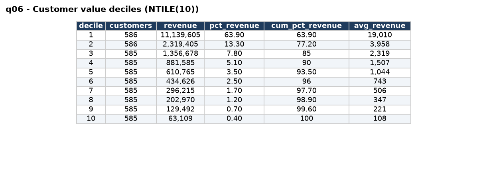
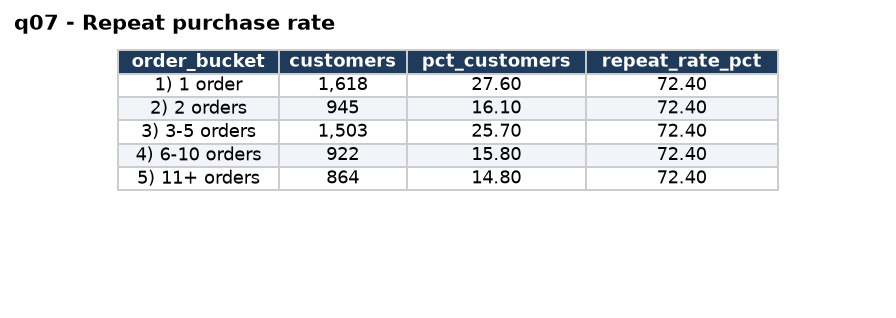
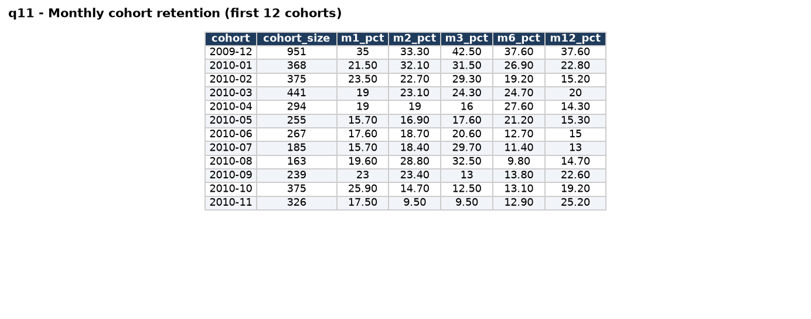
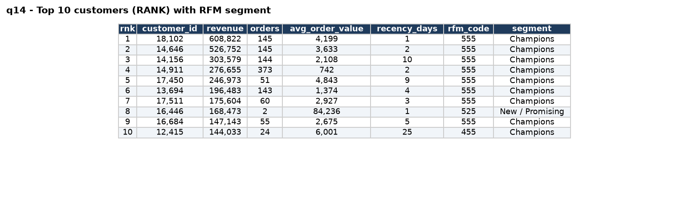
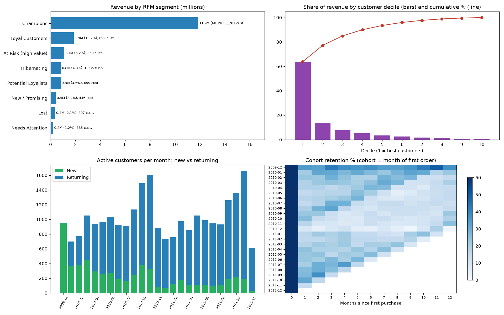

# SQL 03 - Customer Analysis: RFM, Repeat Purchase, CLV & Cohort Retention (PostgreSQL)

## Objective

Answer the classic customer analytics questions with SQL only: who are the best customers, who is slipping away, how many buy again, how much is a customer worth over time and how well each monthly cohort is retained. The project loads over one million real transaction lines into PostgreSQL, builds a clean analysis layer (valid sales, orders, cohorts) and computes **RFM scoring with `NTILE`**, **repeat-purchase rate**, **customer lifetime value** and **monthly cohort retention**, using CTEs, window functions (`NTILE`, `RANK`, `LAG`, running `SUM`), views, constraints and indexes.

---

## Dataset

| Field | Detail |
|---|---|
| Source | UCI Machine Learning Repository - [Online Retail II](https://archive.ics.uci.edu/dataset/502/online+retail+ii) (public, no login) |
| Direct download | https://archive.ics.uci.edu/static/public/502/online+retail+ii.zip (45 MB) |
| Records | 1,067,371 transaction lines (two sheets: 2009-2010 and 2010-2011) |
| Period | 2009-12-01 to 2011-12-09 |
| Business | UK-based online retailer selling giftware, many customers are wholesalers; amounts are in GBP |
| License | CC BY 4.0 |
| File | **Not committed** (45 MB zip / ~94 MB CSV). `run_customer_analysis.py` downloads and converts it into `data/raw/`, which is already git-ignored by the repository (`**/data/raw/`) |

**Key variables:** `Invoice`, `StockCode`, `Description`, `Quantity`, `InvoiceDate`, `Price`, `Customer ID`, `Country`.

---

## Methodology

- **Raw layer** (`01_schema.sql`): typed `raw_transactions` table, bulk-loaded with `COPY`.
- **Analysis layer** (`02_prepare.sql`):
  - `sales_lines`: only valid product sales of identified customers. Excluded: invoices starting with a letter (`C` credit notes, `A` adjustments), non-positive quantity/price, rows without `Customer ID`, and non-product stock codes (`POST`, `DOT`, `M`, `BANK CHARGES`...).
  - `orders` (one row per invoice, primary key) and `customer_first_order` (cohort month).
  - Views `v_customer_summary` and `v_customer_rfm`.
  - Indexes on `(customer_id, invoice_date)`, `invoice`, `order_date`.
- **RFM:** snapshot date = last invoice date + 1 (2011-12-10). Recency = days since last order, Frequency = number of orders, Monetary = total spend. Each dimension is scored 1-5 with `NTILE(5)` (5 = best; recency ordered descending) and mapped to 8 segments with a `CASE` rule set.
- **Customer value:** `NTILE(10)` deciles with cumulative share of revenue; `RANK` for the top-10 customers.
- **Repeat purchase:** customers with 2+ orders / all customers; time between orders with `LAG() OVER (PARTITION BY customer_id ...)`.
- **CLV:** (a) historical CLV to date by first-order half-year cohort; (b) a simple projected CLV = average annual revenue of year-1 customers x r / (1 - r), where r is the observed 12-month retention (year 1 = 2009-12-01..2010-11-30, year 2 = 2010-12-01..2011-11-30).
- **Cohort retention:** cohort = month of first order; `month_offset` computed from year/month difference; retention % = active customers in month N / cohort size (`FILTER` aggregates + a long-format matrix for the heat-map).
- **Validation** (`q15`): line, order and RFM totals reconcile; every customer appears once in RFM and cohort tables.

---

## File Structure

```
sql/03_customer_analysis/
├── 01_schema.sql                <- raw_transactions table
├── 02_prepare.sql               <- sales_lines, orders, customer_first_order, v_customer_summary, v_customer_rfm
├── 03_analysis.sql              <- 16 analysis queries (q01 ... q16)
├── run_customer_analysis.py     <- Downloads the UCI zip, loads PostgreSQL, runs the .sql files, exports CSV + PNG
├── requirements.txt             <- Python dependencies
├── results/                     <- CSV with the real output of every query (+ readme_tables.md)
├── images/                      <- PNG renders of the query output
└── README.md                    <- This file
```

### How to reproduce

```bash
cd sql/03_customer_analysis
uv run --python 3.12 --with pgserver --with pandas --with python-calamine --with matplotlib --with psycopg2-binary python run_customer_analysis.py
# or: pip install -r requirements.txt && python run_customer_analysis.py
```

The first run downloads the 45 MB zip and converts the Excel file to CSV (about 1-2 minutes); building the analysis layer takes another ~1.5 minutes on a laptop (1 million rows). The `.sql` files run top to bottom on any PostgreSQL 13+ once `raw_transactions` is loaded.

---

## Results (real output of the queries)

### Data funnel (`q01`)

| step | rows |
|---|---|
| raw transaction lines | 1,067,371 |
| minus cancellations / adjustments (invoice starts with a letter) | 1,047,871 |
| minus non-positive quantity or price | 1,041,669 |
| minus guest checkouts (no customer id) | 805,549 |
| minus non-product stock codes = `sales_lines` | 802,632 |

### Headline KPIs (`q02`)

| customers | orders | revenue | avg_order_value | orders_per_customer | countries | first_order | last_order |
|---|---|---|---|---|---|---|---|
| 5,852 | 36,594 | 17,434,450 | 476.43 | 6.25 | 41 | 2009-12-01 | 2011-12-09 |

### RFM segments (`q04`)



### Customer value deciles (`q06`)



### Repeat purchase (`q07`) and time between orders (`q08`)

| order_bucket | customers | pct_customers |
|---|---|---|
| 1 order | 1,618 | 27.6 |
| 2 orders | 945 | 16.1 |
| 3-5 orders | 1,503 | 25.7 |
| 6-10 orders | 922 | 15.8 |
| 11+ orders | 864 | 14.8 |

**Repeat purchase rate: 72.4%** (4,234 of 5,852 customers ordered at least twice). Across 30,742 repeat orders the average gap is 52.1 days, the median 25 days, and 55.2% of repeat orders come within 30 days of the previous one (3,716 are same-day orders).



### Customer lifetime value (`q09`, `q10`)

| cohort_half | customers | avg_clv_to_date | avg_orders | avg_order_value | repeat_rate_pct |
|---|---|---|---|---|---|
| 2009-H2 | 951 | 8,957 | 15.9 | 406 | 91.3 |
| 2010-H1 | 2,000 | 2,571 | 6.1 | 382 | 82.1 |
| 2010-H2 | 1,364 | 1,551 | 3.8 | 360 | 66.5 |
| 2011-H1 | 701 | 1,449 | 3.3 | 486 | 61.5 |
| 2011-H2 | 836 | 768 | 2.0 | 368 | 46.2 |

Projected CLV: of 4,239 customers active in year 1, 2,708 were active again in year 2 (**63.9% annual retention**); average year-1 revenue was 1,973, so the simple formula gives a projected CLV of **3,490** per customer. Younger cohorts show lower CLV to date simply because they have had less time to buy.

### Monthly cohort retention (`q11`, first 12 cohorts)



### Top 10 customers (`q14`)



### Dashboard rendered from the query output



### Other queries (see `results/*.csv`)

- `q03` monthly active customers, new vs returning: from 951 customers in 2009-12 (all new) to 1,660 in 2011-11; returning customers are 82-95% of active customers from 2010-12 on.
- `q05` average spend / orders by R x F score (heat-map input).
- `q13` country mix: United Kingdom 83.9% of revenue (5,334 of 5,852 customers); EIRE 3.4% (only 3 customers), Netherlands 3.2% (22 customers, avg order 2,546).
- `q14` top 10 customers: customer 18102 spent 608,822 in 145 orders; 9 of the top 10 are Champions.
- `q15` reconciliation: lines, orders and RFM revenue all equal 17,434,450; 5,852 customers in RFM and cohort tables; 0 lines without customer.
- `q16` credit notes of identified customers on product codes: 719,653 (4.1% of gross sales) from 2,444 customers.

---

## Key Findings

1. **Revenue is extremely concentrated:** the top decile (586 customers) generates 63.9% of revenue and the top 30% generate 85.0%; the bottom half generates 6.5%.
2. **Champions are 21.9% of customers and 68.1% of revenue** (average 17.1 orders, last order 20 days before the snapshot); Loyal Customers add 10.7%.
3. **High-value customers at risk:** 360 customers (6.2%) with 7.6 orders on average and 2,986 average spend have not bought for 343 days on average, representing 1.07M of historical revenue worth a win-back campaign.
4. **72.4% of customers buy again,** but 27.6% never return after their first order; half of all repeat orders happen within 25 days of the previous one.
5. **Retention is structurally high but decays by cohort:** 63.9% annual retention; the first cohort (2009-12, 951 customers) still has 37.6% active 12 months later, while the 2010 cohorts show roughly 10-28% activity 6 and 12 months after their first order.
6. **Returning customers dominate activity** (82-95% of monthly active customers from December 2010), so growth depends on keeping existing buyers more than on acquisition.

---

## Limitations

- **Gross revenue:** cancellations/credit notes are excluded rather than netted against the original sale (they are 4.1% of gross sales, `q16`). A few customers with a large cancelled order stay in the top ranks (e.g. customer 16446: 2 orders, 168,473).
- **Only identified customers:** 22.7% of the positive-quantity, positive-price lines (guest checkouts without `Customer ID`) are outside the analysis; B2B customers (wholesalers) and B2C customers are mixed.
- **RFM ties:** `NTILE` splits tied values arbitrarily (deterministically by `customer_id`); frequency has many ties (27.6% of customers have exactly 1 order), so F scores 1-2 are partly arbitrary within that group. Segment rules are a common convention, not fitted to the data.
- **CLV is a simple revenue-based estimate** (no margin data, no discounting, constant retention, based on one observed year-over-year transition). Dec-2011 is a partial month (to the 9th) and is excluded from the CLV window.
- **Cohorts are by calendar month of first purchase** in a window that starts in 2009-12: customers who bought before December 2009 appear as "new" in that first month (951 customers).
- **Currency is GBP**; no tax or cost information is available.

---

## Tools Used

| Tool | Purpose |
|---|---|
| PostgreSQL 16 | Database engine (embedded through `pgserver`) |
| SQL (CTEs, `NTILE`, `RANK`, `LAG`, views, indexes, `FILTER`) | All the analysis logic |
| Python 3.12 + pandas + python-calamine + psycopg2 | Download, Excel-to-CSV conversion, `COPY` load and result export |
| matplotlib | PNG rendering of the real query output |
