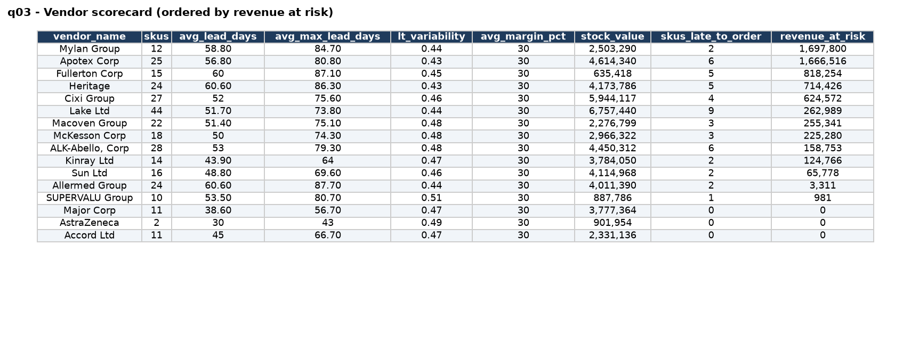
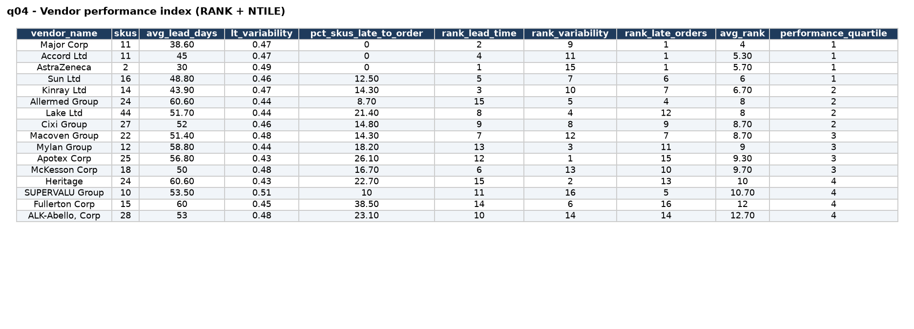
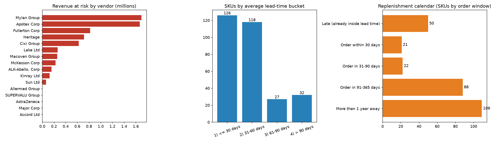
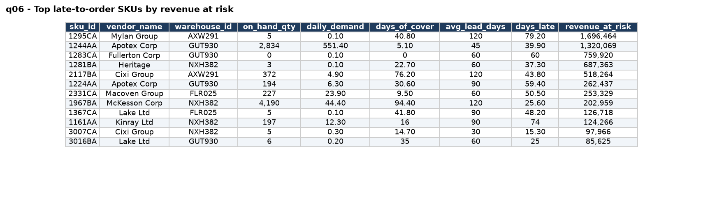
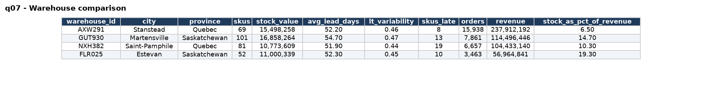

# SQL 04 - Supply Chain Queries: Vendor Lead Times, Replenishment Timing & Warehouse Comparison (PostgreSQL)

## Objective

Use SQL to evaluate the supply side of a distribution network: how long vendors take to deliver and how variable that is, which SKUs should already have been ordered, how much revenue is exposed to those late orders, how the four warehouses compare, and how dependent each warehouse is on single vendors. The project normalises the raw inventory sheet (vendor dimension), builds two reusable views and runs 12 queries with CTEs, `RANK`/`NTILE`/`ROW_NUMBER` window functions, `ROLLUP`, `FILTER` and `PERCENTILE_CONT`.

---

## Dataset

| Field | Detail |
|---|---|
| Source | Kaggle - [Dynamic Inventory Dataset - Kaizen Analytics](https://www.kaggle.com/datasets/andrewniko/dynamic-inventory-dataset-kaizen-analytics) |
| Author | andrewniko |
| Records | 303 SKUs (16 vendors, 4 warehouses) + 33,919 sales order lines |
| Period | Sales 2021-01-01 to 2023-07-30; inventory is a single snapshot |
| File | Re-uses `python/02_inventory_optimization/dataset_kaizen analytics.xlsx` (not duplicated) |
| Database | PostgreSQL 16 (embedded `pgserver`) |

**Key variables:** `Vendor Name`, `Average Lead Time (days)`, `Maximum Lead Time (days)`, `Cost per SKU`, `Unit Price`, `Current Inventory Quantity`, `Warehouse ID`, sales `Order Quantity` / `Revenue`.

---

## Methodology

- **Staging -> normalised model:** the raw sheet is loaded untouched into `stg_inventory`; `02_transform.sql` builds the `vendors` dimension (with `TRIM`, since 26 rows carry trailing spaces) and the `inventory` fact with foreign keys and a `CHECK (max_lead_days >= avg_lead_days)`.
- **Indexes:** `sales(sku_id, order_date)`, `inventory(vendor_id)`, `inventory(warehouse_id)`.
- **Views:** `v_sku_demand_12m` (units, average daily demand and daily sigma over Aug-2022..Jul-2023, zero-filled months) and `v_sku_supply` (SKU + vendor + warehouse + coverage + lead-time variability + margin + `days_to_order_by`).
- **Lead-time variability** = (max lead time - average lead time) / average lead time.
- **Order-by timing:** `days_to_order_by = days of cover - average lead time`. Negative means the SKU is already inside its lead time (an order should already have been placed).
- **Revenue at risk** = days late x average daily demand x unit price, for SKUs that are late.
- **Vendor performance index:** `RANK` on average lead time, lead-time variability and % of SKUs late to order (lower is better); the three ranks are averaged and split into quartiles with `NTILE(4)`.
- **Warehouse view:** inventory side and sales side are aggregated in separate CTEs and joined by warehouse; `ROLLUP (province, warehouse_id)` for subtotals.
- **Safety stock** for a 95% service level: `1.645 x sigma_daily x sqrt(lead time) x unit cost`.

---

## File Structure

```
sql/04_supply_chain_queries/
├── 01_schema.sql              <- Tables (staging, vendors, inventory, sales), constraints, indexes
├── 02_transform.sql           <- Staging -> normalised tables (vendor dimension with TRIM)
├── 03_views.sql               <- v_sku_demand_12m, v_sku_supply
├── 04_analysis.sql            <- 12 analysis queries (q01 ... q12)
├── run_supply_chain.py        <- Loader: creates DB, loads workbook, runs the .sql files, exports CSV + PNG
├── requirements.txt           <- Python dependencies
├── results/                   <- CSV with the real output of every query (+ readme_tables.md)
├── images/                    <- PNG renders of the query output
└── README.md                  <- This file
```

### How to reproduce

```bash
cd sql/04_supply_chain_queries
uv run --python 3.12 --with pgserver --with pandas --with openpyxl --with matplotlib --with psycopg2-binary python run_supply_chain.py
# or: pip install -r requirements.txt && python run_supply_chain.py
```

---

## Results (real output of the queries)

### Network headline (`q12`) and validation (`q01`)

| skus | vendors | avg_lead_days | longest_max_lead_days | stock_value | skus_late_to_order | revenue_at_risk |
|---|---|---|---|---|---|---|
| 303 | 16 | 52.9 | 192 | 54,130,469 | 50 | 6,618,769 |

Validation: 16 raw vendor names -> 16 after `TRIM` (26 rows had trailing spaces, no duplicates created); 0 SKUs with max lead time below average lead time.

### Lead-time buckets (`q02`)

| lead_time_bucket | skus | pct_skus | stock_value | avg_lt_variability |
|---|---|---|---|---|
| 1) <= 30 days | 126 | 41.6 | 9,357,892 | 0.47 |
| 2) 31-60 days | 118 | 38.9 | 28,508,744 | 0.46 |
| 3) 61-90 days | 27 | 8.9 | 8,882,187 | 0.43 |
| 4) > 90 days | 32 | 10.6 | 7,381,646 | 0.45 |

### Vendor scorecard (`q03`)



### Vendor performance index (`q04`)



### Replenishment calendar (`q05`)

| order_window | skus | pct_skus | annual_purchase_value |
|---|---|---|---|
| 1) Late (already inside lead time) | 50 | 17.2 | 41,354,562 |
| 2) Order within 30 days | 21 | 7.2 | 11,629,156 |
| 3) Order in 31-90 days | 22 | 7.6 | 4,579,796 |
| 4) Order in 91-365 days | 88 | 30.3 | 24,819,105 |
| 5) More than 1 year away | 109 | 37.6 | 8,679,061 |



### Top late-to-order SKUs (`q06`)



### Warehouse comparison (`q07`)



### Vendor dependency per warehouse (`q09`, top vendor of each warehouse)

| warehouse_id | vendor_name | skus | stock_value | pct_of_warehouse |
|---|---|---|---|---|
| AXW291 | Cixi Group | 13 | 3,928,764 | 25.3 |
| FLR025 | Major Corp | 9 | 2,087,823 | 19.0 |
| GUT930 | Lake Ltd | 15 | 4,120,824 | 24.4 |
| NXH382 | Sun Ltd | 9 | 2,038,722 | 18.9 |

### Other queries (see `results/*.csv`)

- `q08` ROLLUP: Quebec 26,271,867 (150 SKUs) and Saskatchewan 27,858,603 (153 SKUs); total 54,130,469.
- `q10` safety stock for 95% service: Apotex Corp needs 3,192,650 (15.8% of the network total), Cixi Group 2,559,815, Lake Ltd 2,210,530.
- `q11` long-lead SKUs (> 90 days) vs the rest: average and median gross margin are both 30.0% in both segments (32 vs 271 SKUs).

---

## Key Findings

1. **50 of 290 SKUs with demand (17.2%) are already inside their lead time:** they represent 41.4M of annual purchase value (45% of the total) and 6.6M of revenue at risk if no replenishment is already in transit.
2. **Risk is concentrated in a few vendors:** Mylan Group (1.70M) and Apotex Corp (1.67M) account for 51% of the revenue at risk; Major Corp, Accord Ltd and AstraZeneca have no late SKUs.
3. **Slowest vendors:** Allermed Group and Heritage average 60.6 days of lead time, Fullerton Corp 60.0, against 30.0 for AstraZeneca and 38.6 for Major Corp. In the composite index Major Corp, Accord Ltd, AstraZeneca and Sun Ltd are the top quartile; ALK-Abello, Fullerton Corp, SUPERVALU Group and Heritage the bottom quartile.
4. **Lead time uncertainty is uniform:** every vendor's maximum lead time is 42-51% above its average, so variability does not discriminate between vendors; average lead time and late orders do.
5. **Estevan (FLR025) is the most capital-heavy warehouse for its sales:** stock equals 19.3% of its revenue (Stanstead 6.5%); Saint-Pamphile (NXH382) has the most late SKUs (19).
6. **Single-vendor dependency is moderate:** the largest vendor in any warehouse holds at most 25.3% of its stock value (Cixi Group in Stanstead).

---

## Limitations

- **Uniform 30% margin:** `Unit Price` is exactly cost / 0.7 for every SKU, so margin cannot differentiate vendors (q11) - a sign that prices are synthetic.
- **Snapshot inventory, no open purchase orders:** the dataset has no in-transit/PO data, so "late to order" is a theoretical flag (it assumes nothing has been ordered yet), and revenue at risk is an upper bound.
- **Revenue at risk uses list unit price** and the 12-month average daily demand; demand dropped sharply in 2023 (see `sql/02_sales_reporting`), which affects cover and order-by timing.
- **One warehouse per SKU in inventory,** while sales are recorded in several warehouses per SKU, so warehouse-level coverage is approximate.
- **Lead times are given as average/maximum only,** so the real on-time delivery rate of each vendor cannot be measured.
- **Currency not stated** in the dataset.

---

## Tools Used

| Tool | Purpose |
|---|---|
| PostgreSQL 16 | Database engine (embedded through `pgserver`) |
| SQL (CTEs, window functions, ROLLUP, views, indexes) | All the analysis logic |
| Python 3.12 + pandas + psycopg2 | Workbook loading (`COPY`) and result export |
| matplotlib | PNG rendering of the real query output |
