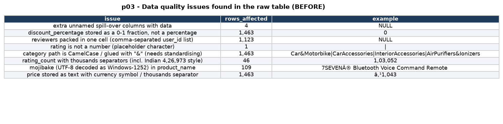
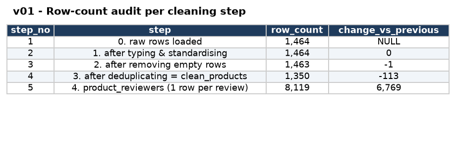
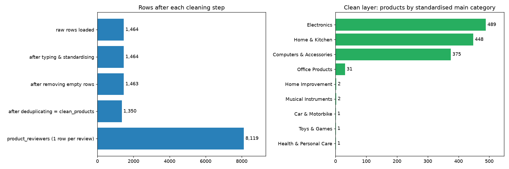
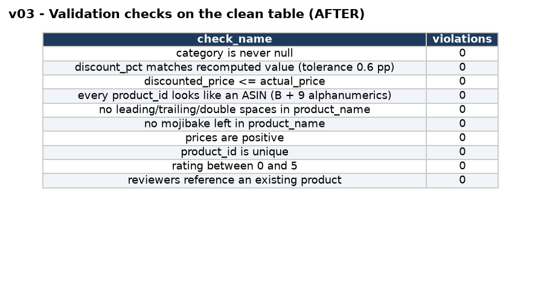
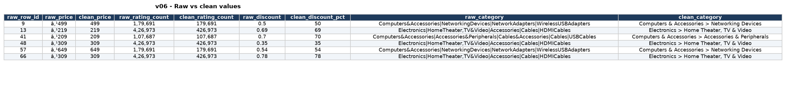

# SQL 05 - Data Cleaning: Raw Amazon India Product Data in PostgreSQL

## Objective

Take a genuinely messy export (the **raw** Amazon India sheet, before any Python cleaning) and clean it with SQL only: profile the problems, cast types, standardise text and categories, remove duplicates and empty rows, normalise a packed reviewer list into a proper table, and prove the result with validation queries and a before/after row audit. Every cleaning decision is made in a `.sql` file; Python is only used to load the sheet as text and export results.

---

## Dataset

| Field | Detail |
|---|---|
| Source | Kaggle - [Amazon Sales Dataset](https://www.kaggle.com/datasets/karkavelrajaj/amazon-sales-dataset) |
| Author | karkavelrajaj |
| Records | 1,464 raw rows x 32 columns (16 named + 16 unnamed spill-over columns) |
| Period | Product catalogue snapshot of Amazon India (no transaction dates) |
| File | Re-uses the raw sheet `python/01_sales_eda/amazon.xlsx` (not duplicated) |
| Database | PostgreSQL 16 (embedded `pgserver`) |

**Key variables:** `product_id`, `product_name`, `category` (pipe-separated path), `discounted_price`, `actual_price`, `discount_percentage`, `rating`, `rating_count`, `user_id` / `review_id` (comma-separated lists).

> The sheet has **no date columns**, so date standardisation does not apply to this dataset.

---

## Methodology

1. **Raw layer** (`01_schema.sql`): all 32 columns loaded as `TEXT`, nothing converted at load time.
2. **Profile BEFORE** (`02_profile.sql`): null profile, pattern checks (regex) for format problems, duplicate analysis.
3. **Clean** (`03_clean.sql`), logged step by step in `cleaning_log`:
   - Reusable functions: `fix_mojibake()` (UTF-8 decoded as Windows-1252, e.g. `–` -> `–`) and `std_category()` (`Computers&Accessories` -> `Computers & Accessories`, `OfficeProducts` -> `Office Products`).
   - **Type casting:** prices `'₹1,043'` -> `NUMERIC(10,2)`; `rating_count` `'4,26,973'` -> `INT`; `discount_percentage` `0.64` -> `64.00`; `rating` placeholder `'|'` -> `NULL` (not imputed).
   - **Text standardisation:** whitespace collapsed, `TRIM`, upper-case ASIN, category path split into `main_category` / `sub_category` / `leaf_category`.
   - **Quarantine** (`rejected_rows`) instead of silent deletes: empty listing and duplicates are stored with a reason.
   - **Deduplication** by `product_id` with `ROW_NUMBER()`: keep the most complete row (has `rating_count`, has link), first row on ties.
   - **Constraints** on `clean_products`: primary key, price > 0, `discounted_price <= actual_price`, rating 0-5, discount 0-100.
   - **Normalisation:** `product_reviewers` (one row per `product_id` + `review_id` + `user_id`) from the comma-separated lists with `unnest ... WITH ORDINALITY`.
   - Indexes on `main_category` and `rating`; view `v_category_summary`.
4. **Validate AFTER** (`04_validation.sql`): integrity checks that must return 0 violations, null profile, row audit, raw-vs-clean examples.

---

## File Structure

```
sql/05_data_cleaning/
├── 01_schema.sql              <- Raw layer (all TEXT)
├── 02_profile.sql             <- BEFORE: profiling queries (p01 ... p05)
├── 03_clean.sql               <- Functions + cleaning pipeline + clean tables + view
├── 04_validation.sql          <- AFTER: validation and audit queries (v01 ... v08)
├── run_data_cleaning.py       <- Loader: creates DB, loads the raw sheet as text, runs the .sql files, exports CSV + PNG
├── requirements.txt           <- Python dependencies
├── results/                   <- CSV with the real output of every query (+ readme_tables.md)
├── images/                    <- PNG renders of the query output
└── README.md                  <- This file
```

### How to reproduce

```bash
cd sql/05_data_cleaning
uv run --python 3.12 --with pgserver --with pandas --with openpyxl --with matplotlib --with psycopg2-binary python run_data_cleaning.py
# or: pip install -r requirements.txt && python run_data_cleaning.py
```

---

## Results (real output of the queries)

### BEFORE - problems found in the raw table (`p01`-`p04`)



- 1,464 rows but only 1,351 distinct `product_id` (113 surplus rows); 1 row carries no business data (no category, prices or rating).
- 91 product ids are repeated (max 3 rows per id): 11 are identical copies and 80 differ in some attribute (`img_link`, `product_link`, `rating_count`, ...), so a plain `DISTINCT` would not remove them.
- Null profile: `product_link` 375 (25.6%), `user_id` 337 (23.0%), `rating_count` 3, and 1 row each for category, prices, discount and rating.

### Row audit (`v01`) and quarantine (`v02`)

| step | row_count |
|---|---|
| 0. raw rows loaded | 1,464 |
| 1. after typing & standardising | 1,464 |
| 2. after removing empty rows | 1,463 |
| 3. after deduplicating = `clean_products` | 1,350 |
| 4. `product_reviewers` (a different table: 1 row per review) | 8,119 |

| reason | rows |
|---|---|
| duplicate product_id (less complete copy) | 113 |
| no price, category or rating (empty listing) | 1 |




### AFTER - validation checks (`v03`), all must be 0



Remaining nulls on purpose (`v04`): `rating` 1, `rating_count` 2, `product_link` 351 of 1,350 rows. Nothing was imputed.

### Raw vs clean examples (`v06`)



### Standardised categories (`v05`)

| main_category | products | avg_discount_pct | avg_rating | total_ratings |
|---|---|---|---|---|
| Electronics | 489 | 49.9 | 4.08 | 14,202,208 |
| Home & Kitchen | 448 | 40.1 | 4.04 | 2,991,069 |
| Computers & Accessories | 375 | 53.2 | 4.15 | 6,335,182 |
| Office Products | 31 | 12.4 | 4.31 | 149,675 |
| Home Improvement | 2 | 57.5 | 4.25 | 8,566 |
| Musical Instruments | 2 | 46.0 | 3.90 | 88,882 |
| Car & Motorbike | 1 | 42.0 | 3.80 | 1,118 |
| Toys & Games | 1 | 0.0 | 4.30 | 15,867 |
| Health & Personal Care | 1 | 53.0 | 4.00 | 3,663 |

### Reviewer normalisation (`v08`)

1,127 products have a reviewer list; in all 1,127 the `user_id` list and the `review_id` list have the same length, which gives 8,119 review rows from 6,976 distinct reviewers.

---

## Key Findings

1. **Duplicates are not exact copies:** 113 surplus rows (7.7%) come from 91 repeated product ids, and 80 of those ids have conflicting attributes, so deduplicating needs a ranking rule (`ROW_NUMBER`), not `DISTINCT`.
2. **Almost every numeric field was text:** 1,463 of 1,463 prices carried a mangled currency symbol, 46 rating counts contained thousands separators (Indian grouping such as `4,26,973`), and the discount was a 0-1 fraction.
3. **Encoding damage:** 109 raw product names contained mojibake; after `fix_mojibake()` none remains.
4. **The clean layer satisfies 10/10 validation checks** (unique ASIN, positive prices, discounted <= actual, rating 0-5, recomputed discount within 0.6 pp of the stated one, no encoding artefacts, no stray spaces, referential integrity of reviewers).
5. **Net effect:** 1,464 raw rows -> 1,350 unique products plus 8,119 normalised review rows, with 114 rejected rows documented in `rejected_rows`.

---

## Limitations

- **Encoding repair is a replacement table,** not a general decoder: it covers the sequences found in this file (`–`, `’`, `“`, `â€\x9d`, `®`, `â„¢`, `Â`, ...) and the validation check confirms none remain in `product_name`; `about_product` is repaired with the same function but is not validated.
- **Deduplication keeps one row per `product_id`:** the less complete copies (which may hold other review samples) are discarded; only the ids of reviewers of the kept row are stored in `product_reviewers`.
- **`review_title` / `review_content` are not split** because they contain commas and cannot be aligned with the id lists safely; they stay in the raw layer.
- **Missing values are kept as `NULL`** (no imputation), unlike the Python project which imputes the mean rating.
- **No dates exist in this dataset,** so date standardisation could not be demonstrated here.

---

## Tools Used

| Tool | Purpose |
|---|---|
| PostgreSQL 16 | Database engine (embedded through `pgserver`) |
| SQL (regex, `ROW_NUMBER`, `unnest WITH ORDINALITY`, PL/pgSQL functions, constraints) | All cleaning logic |
| Python 3.12 + pandas + psycopg2 | Raw sheet loading (`COPY`) and result export |
| matplotlib | PNG rendering of the real query output |
