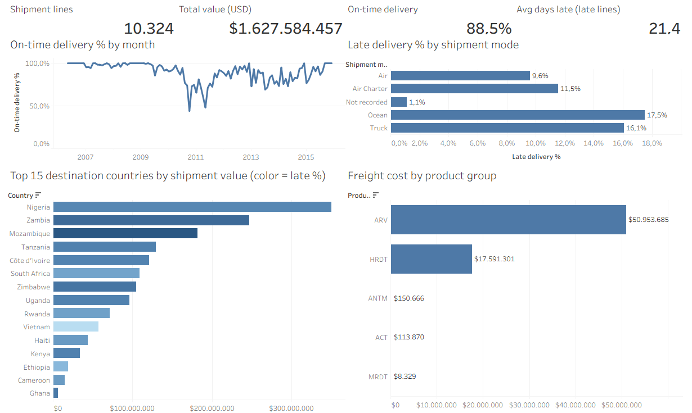

# Tableau 01 - Logistics Dashboard

## Objective

Give a supply chain manager one page to answer: how many shipments are late, on which transport modes and to which countries, and where does the freight money go.

---

## Dataset

| Field | Detail |
|---|---|
| Source | USAID / PEPFAR Supply Chain Shipment Pricing Data ([USAID Data](https://data.usaid.gov/HIV-AIDS/Supply-Chain-Shipment-Pricing-Data/a3rc-nmf6)); same cleaned file as Power BI 02 and ML 03 |
| Records | 10,324 order lines, 43 destination countries |
| Period | Lines scheduled between May 2006 and December 2015 |
| Files | `data/scms_lines.csv` (source extract), `01_logistics_dashboard.twbx` (workbook with the data embedded as a Hyper extract) |

`Late` = 1 when the line was not delivered on time (`OnTime` is not "On time"). `Year` and `YearMonth` come from the scheduled date.

---

## Dashboard

| Block | What it shows |
|---|---|
| KPI row | Shipment lines, total value (USD), on-time delivery %, average days late (late lines only) |
| On-time % by month | Monthly trend; the 2010-2011 dip is the worst stretch of the series |
| Late % by shipment mode | Late share per transport mode |
| Top 15 destination countries | Shipment value, sorted, colored by late % (darker = later) |
| Freight cost by product group | Freight USD per product group |

### Calculated fields

| Field | Formula |
|---|---|
| On-time delivery % | `1 - SUM([Late]) / COUNT([LineID])` |
| Late delivery % | `SUM([Late]) / COUNT([LineID])` |
| Avg days late (late lines only) | `SUM(IF [Late] = 1 THEN [DaysLate] END) / SUM([Late])` |

---

## Key Findings

- 88.5% of the 10,324 lines were delivered on time; late lines averaged 21.4 days late.
- Ocean (17.5%) and Truck (16.1%) have the highest late rates; Air is at 9.6% and Air Charter at 11.5%.
- Nigeria, Zambia and Mozambique concentrate the highest shipment value.
- ARV products carry most of the freight cost ($51.0M), followed by HRDT ($17.6M).

Figures in the dashboard were checked against an independent pandas calculation on the same CSV (lines, total value, on-time %, average days late, late rate by mode, top countries, freight by group).

---

## Limitations

- Freight is only numeric for 6,198 of the 10,324 lines; the rest are recorded as text (for example, freight included in the commodity cost) and are excluded from the freight chart.
- "Not recorded" shipment mode (1.1% late) is a data gap, not a transport mode.
- The workbook is built for Tableau Public 2026.3 or later. Published on Tableau Public: https://public.tableau.com/app/profile/gustavo.inciarte/viz/01_logistics_dashboard/Logisticsdashboard

---

## Tools

Tableau Public 2026.3 (workbook and Hyper extract), Python (data preparation and extract build).
