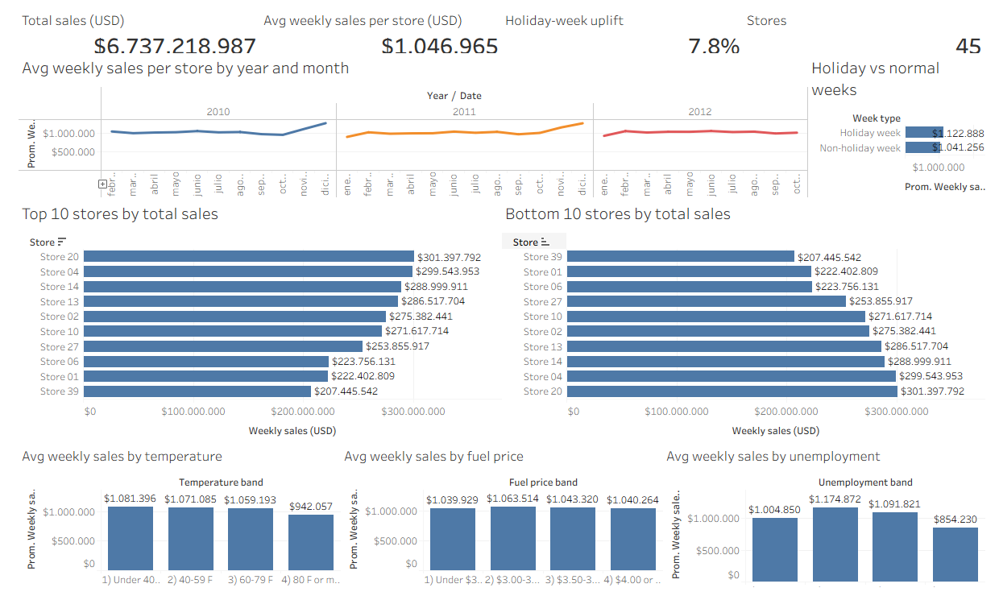

# Tableau 02 - Sales Performance Dashboard

## Objective

Give a retail operations manager one page to answer: how much do the stores sell, which stores lead and which lag, how much do holiday weeks add, and does weekly revenue move with temperature, fuel price or unemployment.

---

## Dataset

| Field | Detail |
|---|---|
| Source | Walmart weekly sales by store ([Kaggle](https://www.kaggle.com/datasets/mikhail1681/walmart-sales)); same file as Excel 02 |
| Records | 6,435 store-weeks, 45 stores |
| Period | 5 Feb 2010 to 26 Oct 2012 (2010 starts in February and 2012 ends in October, so those years are partial) |
| Files | `data/walmart_weekly_sales.csv` (source extract), `02_sales_performance.twbx` (workbook with the data embedded as a Hyper extract) |

`Holiday` marks the 450 holiday weeks. Temperature is in degrees Fahrenheit, fuel price in USD per gallon, unemployment in percent (regional values attached to each store-week).

---

## Dashboard

| Block | What it shows |
|---|---|
| KPI row | Total sales, average weekly sales per store, holiday-week uplift, number of stores |
| Avg weekly sales by year and month | One panel per year; the seasonal climb in November-December is visible in every panel |
| Holiday vs normal weeks | Average weekly sales in holiday and non-holiday weeks |
| Top 10 / Bottom 10 stores | Total sales per store (Top N filter, sorted bars) |
| Sales by temperature, fuel price and unemployment | Average weekly sales per store-week inside four bands of each variable |

### Calculated fields

| Field | Formula |
|---|---|
| Holiday-week uplift % | `AVG(IF [Holiday] = 'Holiday week' THEN [Weekly_Sales] END) / AVG(IF [Holiday] = 'Non-holiday week' THEN [Weekly_Sales] END) - 1` |
| Temperature band | `IF [Temperature] < 40 THEN '1) Under 40 F' ELSEIF [Temperature] < 60 ... END` (bands: <40, 40-59, 60-79, 80+) |
| Fuel price band | bands: under $3.00, $3.00-3.49, $3.50-3.99, $4.00+ |
| Unemployment band | bands: under 7%, 7-7.9%, 8-8.9%, 9%+ |

---

## Key Findings

- Total sales are $6,737,218,987 over 6,435 store-weeks; the average store-week is $1,046,965.
- Holiday weeks average $1,122,888 against $1,041,256 for normal weeks: an uplift of 7.8%.
- Store 20 ($301.4M), Store 04 ($299.5M) and Store 14 ($289.0M) lead; Store 39 ($207.4M), Store 01 ($222.4M) and Store 06 ($223.8M) close the bottom 10 shown. These totals are only comparable because every store has the same number of weeks (143).
- Average weekly sales rise sharply in November and December in all years (about $1.28M in December against about $1.0M in a typical month) and are lowest in January.
- Weeks above 80 F average $942,057, about 12% below the 40-59 F band ($1,071,085). Fuel price shows no clear pattern (all bands between $1.04M and $1.06M).
- By unemployment band the averages are $1.00M (<7%), $1.17M (7-7.9%), $1.09M (8-8.9%) and $0.85M (9%+). This is not monotonic and is driven by which stores sit in which region, so it is an association between store groups, not an effect of unemployment.

All figures in the dashboard were checked against an independent pandas calculation on the same CSV (`check_numbers.py`: totals, average, uplift, top and bottom 10, the three band tables).

---

## Limitations

- The bands compare store-weeks across different stores; temperature, fuel price and unemployment are confounded with store size, region and season (hot weeks are summer weeks, which are not the November-December peak). Read them as descriptive, not causal.
- 2010 starts in February and 2012 ends in October, so year-to-year comparisons use partial years.
- The Top/Bottom charts show store totals over the whole period, not per-year rankings.
- Month names follow the language of the Tableau installation (Spanish in the screenshot); number separators likewise.
- The last x-axis labels of the unemployment chart are slightly clipped in the screenshot taken in presentation mode.
- The workbook is built for Tableau Public 2026.3 or later. Published on Tableau Public: https://public.tableau.com/app/profile/gustavo.inciarte/viz/02_sales_performance/Salesperformancedashboard

---

## Tools

Tableau Public 2026.3 (workbook and Hyper extract), Python (extract build and pandas verification).
