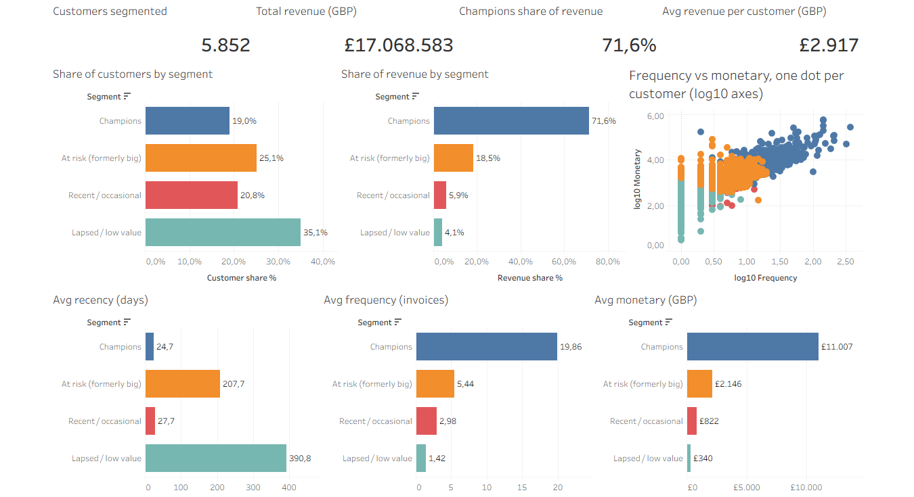

# Tableau 03 - Customer Segmentation Dashboard

## Objective

Give a commercial manager one page to answer: how are customers split into behavioural segments, how much revenue does each segment bring, and how do recency, frequency and spend differ between them.

---

## Dataset

| Field | Detail |
|---|---|
| Source | RFM segments produced by [ML 04 - Customer Segmentation](../../ml/04_customer_clustering) from UCI Online Retail II (CC BY 4.0) |
| Records | 5,852 customers (one row each) with Recency (days), Frequency (invoices), Monetary (GBP) and Segment |
| Period | Transactions from 1 Dec 2009 to 9 Dec 2011 (see the ML project for the cleaning rules) |
| Files | `data/customer_segments.csv`, `data/segment_profile.csv` (copies of the ML outputs), `03_customer_segmentation.twbx` (workbook with the data embedded as a Hyper extract), `check_numbers.py` |

Segment names are the ones assigned in the ML project (K-Means, k = 4).

---

## Dashboard

| Block | What it shows |
|---|---|
| KPI row | Customers segmented, total revenue, Champions share of revenue, average revenue per customer |
| Share of customers / revenue by segment | Two sorted bars with the same segment order and colours, so the size-versus-revenue gap is visible |
| Frequency vs monetary | One dot per customer, coloured by segment, both axes on a log10 scale |
| Avg recency / frequency / monetary | Mean of each RFM variable per segment |

### Calculated fields

| Field | Formula |
|---|---|
| Revenue share % | `SUM([Monetary]) / MIN({ FIXED : SUM([Monetary]) })` |
| Customer share % | `COUNT([CustomerID]) / MIN({ FIXED : COUNT([CustomerID]) })` |
| Champions revenue share | `SUM(IF [Segment] = 'Champions' THEN [Monetary] END) / SUM([Monetary])` |
| log10 Frequency / log10 Monetary | `AVG(LOG([Frequency]))`, `AVG(LOG([Monetary]))` (one value per dot) |

---

## Key Findings

- 5,852 customers generate GBP 17,068,583 (average GBP 2,917 per customer).
- Champions are 19.0% of customers (1,110) and 71.6% of revenue; Lapsed / low value is 35.1% of customers and 4.1% of revenue.
- At risk (formerly big): 25.1% of customers, 18.5% of revenue, 207.7 days since last order on average and GBP 2,146 per customer: the largest recoverable pool.
- Recent / occasional: 20.8% of customers, 5.9% of revenue, 27.7 days, 2.98 invoices, GBP 822 per customer.
- Averages by segment: Champions 24.7 days / 19.86 invoices / GBP 11,007; At risk 207.7 / 5.44 / GBP 2,146; Recent 27.7 / 2.98 / GBP 822; Lapsed 390.8 / 1.42 / GBP 340.

All figures were checked against an independent pandas calculation on the same CSV (`check_numbers.py`: customers, total, average, segment counts, revenue shares and the three RFM means).

---

## Limitations

- The dashboard shows **means**; the ML README quotes **medians** (e.g. Champions recency 15 days), so the two do not match by design.
- The segments are an output of K-Means on log-scaled RFM; they are a description of the customer base, not a prediction. Forward validation is in the ML project.
- On the scatter, vertical stripes at low frequency come from frequency being a whole number of invoices.
- Months, decimal and thousands separators follow the language of the Tableau installation (Spanish in the screenshot: `71,6%` is 71.6%).
- Filter actions between the charts were not configured or tested.
- The workbook is built for Tableau Public 2026.3 or later. A link to the published version will be added here once it is published.

---

## Tools

Tableau Public 2026.3 (workbook and Hyper extract), Python (extract build and pandas verification).
