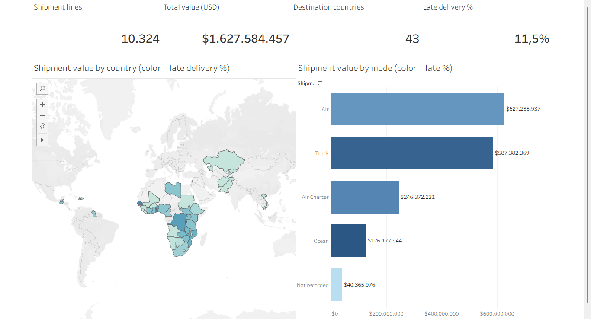

# Tableau 04 - Supply Chain Map

## Objective

Show a supply chain manager where the shipments go and where deliveries arrive late: a country map colored by late delivery %, the value moved per transport mode, and the headline totals.

---

## Dataset

| Field | Detail |
|---|---|
| Source | USAID / PEPFAR Supply Chain Shipment Pricing Data ([USAID Data](https://data.usaid.gov/HIV-AIDS/Supply-Chain-Shipment-Pricing-Data/a3rc-nmf6)); same cleaned file as dashboard 01, Power BI 02 and ML 03 |
| Records | 10,324 order lines aggregated to 43 destination countries |
| Files | `data/scms_by_country.csv` (lines, value, quantity, late lines, freight per country), `data/scms_country_mode.csv` (country x shipment mode), `04_supply_chain_map.twbx` (workbook, data embedded as Hyper extracts), `check_numbers.py` |

Two country names were renamed in the CSV (Ivory Coast, Democratic Republic of the Congo) so Tableau geocodes them. `Late` lines = lines not delivered on time.

---

## Dashboard

| Block | What it shows |
|---|---|
| KPI row | Order lines, total value (USD), destination countries, late delivery % |
| Country map | Filled map of the 43 countries colored by late delivery %; tooltip with lines, value and late % |
| Value by shipment mode | Shipment value per mode (second data source), colored by late % |

### Calculated fields

| Field | Formula |
|---|---|
| Late delivery % | `SUM([LateLines]) / SUM([Lines])` (both data sources) |

---

## Key Findings

- 10,324 lines, $1,627.6M of value, 43 countries, 11.5% of lines late.
- Highest value: Nigeria ($350.3M), Zambia ($247.0M), Mozambique ($182.0M), Tanzania ($129.5M), Ivory Coast ($120.9M).
- Among countries with 100+ lines, the highest late rates are the Democratic Republic of the Congo (24.9%), Mozambique (18.4%) and Zambia (15.8%); the lowest are Vietnam (0.9%), Ethiopia (5.6%) and South Africa (8.2%).
- By mode: Air $627.3M (9.6% late), Truck $587.4M (16.1%), Air Charter $246.4M (11.5%), Ocean $126.2M (17.5%).

All numbers were checked against `check_numbers.py` (pandas on the same CSVs); the dashboard totals, mode values and map color scale were read from the Tableau screenshot (the map's per-country values were not each compared one by one).

---

## Limitations

- The map covers only the 43 destination countries in the data; the rest of the world is grey, and the map opens at world zoom.
- Late % on small countries rests on few lines (some have fewer than 10).
- "Not recorded" shipment mode (360 lines, 1.1% late) is a data gap, not a transport mode.
- No filter actions between map and bars were configured or tested.
- The workbook is built for Tableau Public 2026.3 or later; published on Tableau Public: https://public.tableau.com/app/profile/gustavo.inciarte/viz/04_supply_chain_map/Supplychainmap
