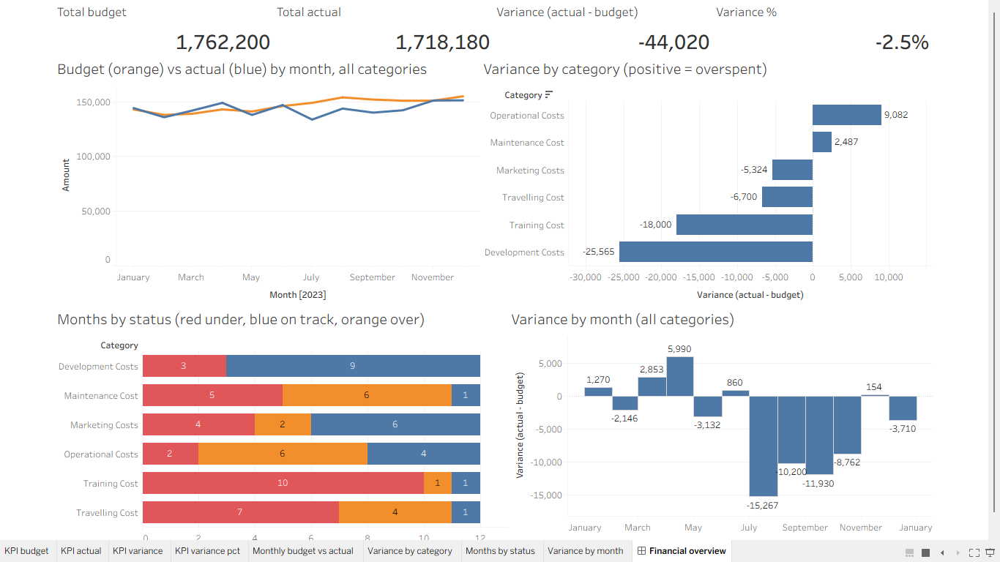

# Tableau 05 - Financial Overview

## Objective

Show a finance reader how actual spending compares with the budget: the year totals, the month-by-month gap and which cost categories were over or under budget.

---

## Dataset

| Field | Detail |
|---|---|
| Source | Kaggle - [Financial Dataset - Expenses Budget vs Actual](https://www.kaggle.com/datasets/saharsyed/financial-dataset-expenses-budget-vs-actual) (author saharsyed); same data as Excel 05 |
| Records | 72 rows in the wide file (12 months x 6 categories) and 144 rows in the long file (adds Budget / Actual type) |
| Period | January - December 2023 |
| Files | `data/budget_vs_actual.csv` (Budget, Actual, Variance, Variance %, Status per month and category), `data/budget_vs_actual_long.csv` (one row per month, category and type), `05_financial_overview.twbx` (workbook, data embedded as Hyper extracts), `check_numbers.py` |

The source does not state a currency, so amounts are shown as plain numbers. `Variance = Actual - Budget` (positive = overspent). `Status` is **Under budget** below -5%, **Over budget** above +5% and **On track** in between (Excel 05 uses a 10% threshold, so the status counts differ between the two projects).

---

## Dashboard

| Block | What it shows |
|---|---|
| KPI row | Total budget, total actual, variance, variance % |
| Budget vs actual by month | Line chart from the long file (second data source): orange = Budget, blue = Actual |
| Variance by category | Bars sorted from the most overspent category to the most underspent |
| Months by status | Number of months each category was under (red), on track (blue) or over (orange) budget |
| Variance by month | Actual - budget per month, all categories |

### Calculated fields

| Field | Formula |
|---|---|
| Variance % | `SUM([Variance]) / SUM([Budget])` |

---

## Key Findings

- Budget 1,762,200; actual 1,718,180; variance -44,020 (-2.5%): the year closed under budget.
- Only two categories overspent: Operational Costs (+9,082, +5.5%) and Maintenance Cost (+2,487, +5.2%). Marketing (-5,324, -7.1%), Travelling (-6,700, -14.0%), Training (-18,000, -20.9%) and Development (-25,565, -1.9%) finished under budget.
- Operational Costs was over budget in 6 of 12 months, Maintenance in 6, Travelling in 4; Training was under budget in 10 months.
- The gap is concentrated in July - October (variance between -8,762 and -15,267 each month); the largest overspend month is April (+5,990).

All numbers were checked with `check_numbers.py` (pandas on the same CSVs). The dashboard KPIs, category variances and monthly variances were read from the Tableau screenshot and match; the line chart values were compared by shape only, not point by point.

---

## Limitations

- One year of data with 6 categories (72 category-months): status counts are small numbers.
- Development Costs is about 76% of the budget, so the total variance mostly follows that one category.
- Tableau displays numbers with the thousands separator of the computer's locale (dots on the machine that took the screenshot).
- The status bands (+/-5%) are a choice made for this dashboard.
- Chart colors are explained in the titles, as legends were not added to the dashboard layout; no filter actions were configured or tested.
- The workbook is built for Tableau Public 2026.3 or later; published on Tableau Public: https://public.tableau.com/app/profile/gustavo.inciarte/viz/05_financial_overview/Financialoverview
